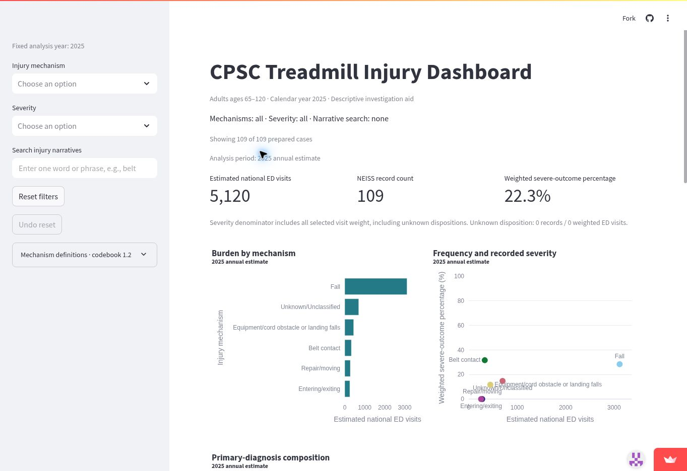
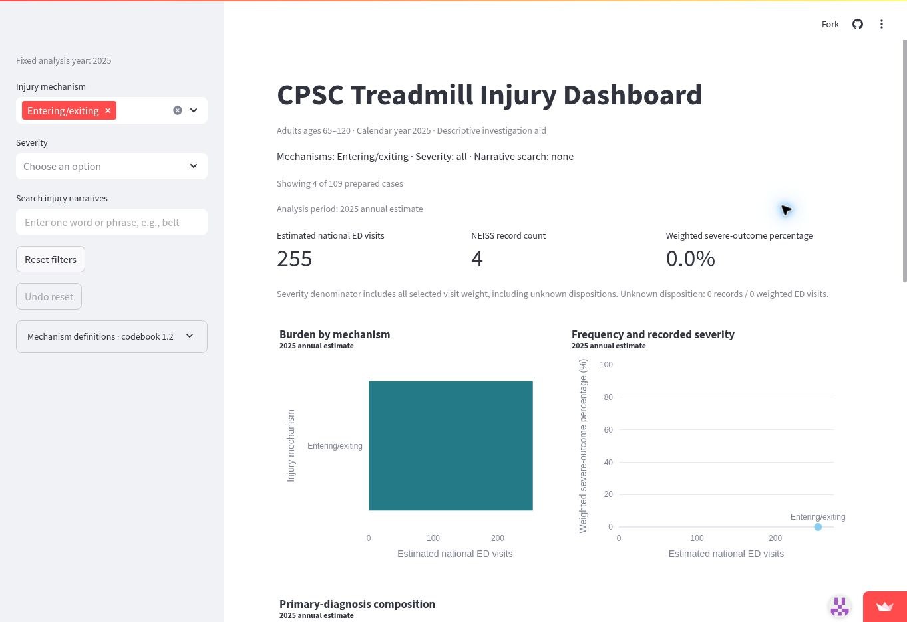
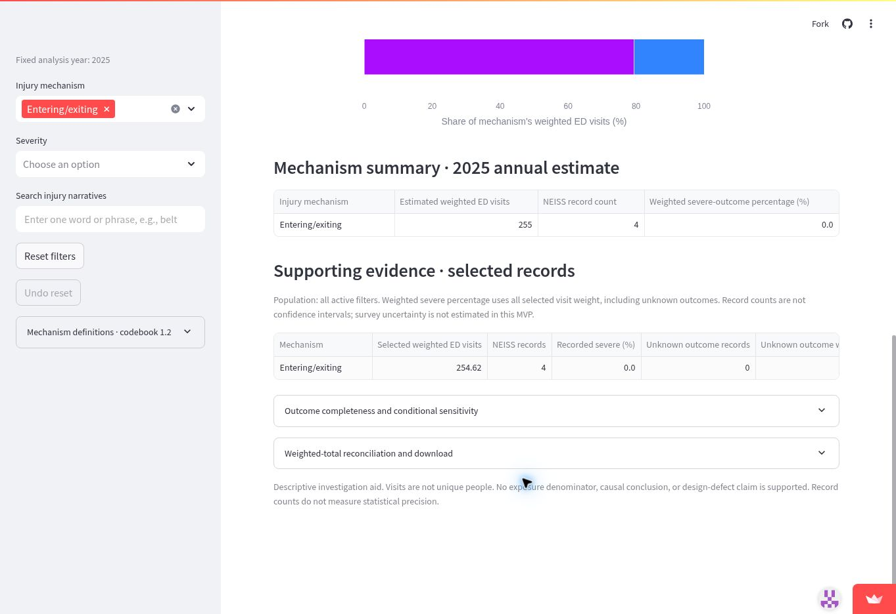
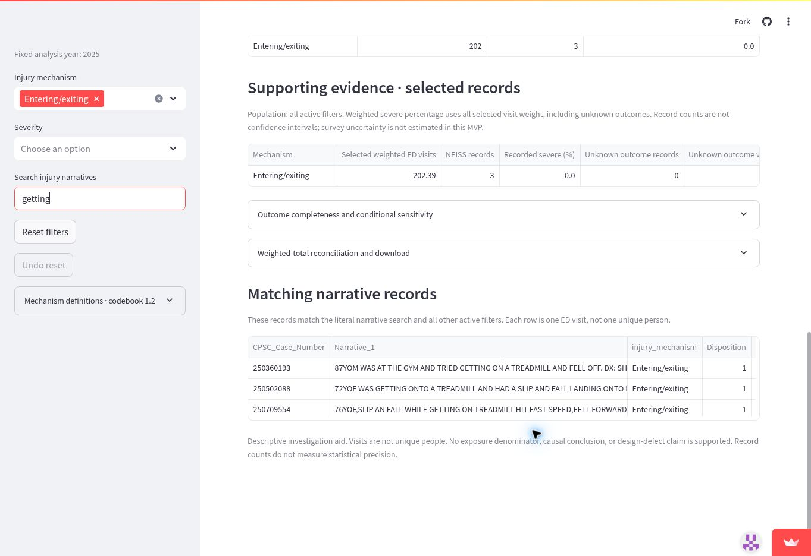
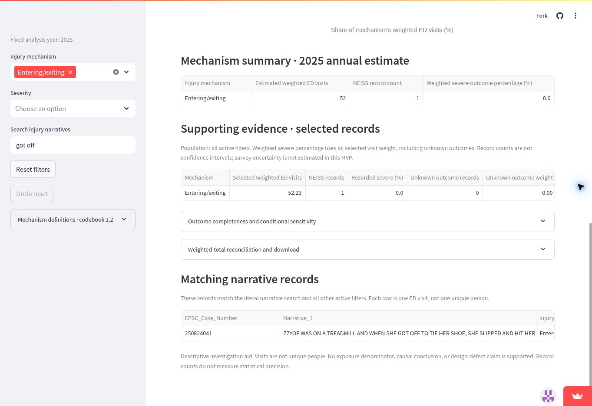

# Case: Write the person's name and their decision here

> **Individual. Hand in one PDF file**, not this Markdown file: one case for **your team's
> app**, one specific person using it for one real decision, with screenshots of your team's
> **live app**. Upload the PDF to **Brightspace → Hand In Work** before Quiz 11. Your team also
> puts it in Section 2 (*Cases*) of its MVP `validation.pdf`, graded by MVP criteria 6 and 7 in
> `mvp.md` (in your section's repo). Full instructions: Module 11 handout, 11.7 and *What to hand in*. The four
> questions are in 11.1, and how to make the PDF is in 11.4.
>
> **Where to write.** Copy this file into your team's private repo, in any folder your team
> chooses, and rename it for your person, such as `ana-orders.md`. Save screenshots in a folder
> `screenshots/` next to it. Push as you go, so teammates can see your case.
>
> **In class, for Mei,** use `mei-case.md` in your section's repo instead: it is set up for
> copying in your `/class` answers.
>
> **Claim your person first.** Agree as a team who takes which person and decision, or fill in
> part 1, push this file and tell your teammates: the earlier claim keeps it. A case for the same
> person and decision as a teammate's earlier claim does not count. Together, the team's cases
> should cover your main kinds of users and at least one difficult case.
>
> Five parts: **1** the person and the decision; **2** their real situation and their
> alternatives, from at least two sources; **3** the app in use, with live-app screenshots; **4**
> reading the result for their decision; **5** the verdict: prove the app is as good as it gets
> for this person, or break it with a change request. Codex can find sources, take screenshots
> and make the PDF. What the result means for this person, and the verdict, are yours.

<!--
  How to fill it in:
  - All five parts are required. Replace every placeholder that says "Write" or "Paste",
    including the title. Keep the headings. The boxed lines,
    which start with >, may stay in the PDF; these comments do not show in it.
  - Show what you did and what you saw, not only a conclusion: the selections, the numbers on
    the screen, the source and what it says, the check you ran and its result.
  - Make the PDF as in handout 11.4, with the Markdown Preview Enhanced extension installed in
    VS Code: right-click in the file, "Markdown Preview Enhanced: Open Preview to the Side",
    then right-click in the preview, "Export -> Chrome (Puppeteer) -> PDF". Name it for your
    person, such as case-ana-orders.pdf. Open it and check that every screenshot is readable.
    If the export fails, ask Codex to fix it.
-->

## 1. The person and the decision

> **Enough:** a specific person and one decision your app is for, so that a reader who has never
> seen your project can picture it.

<!-- Who they are, with a name you make up and their job or situation; the decision; when it comes up;
     and what they lose if they decide badly. "A store manager" is too general; "Ana, who
     manages a grocery store and decides each Thursday how much fresh produce to order for the
     next week" is a person. A difficult case is welcome: a user the app serves badly, or one at
     the edge of what it is for. Two to four sentences. -->

Sarah Chen is a wellness program director at a community senior center where adults aged 65 and older use shared treadmills. Before the next new-member orientation, she must decide whether to add a brief, staff-led demonstration on how to safely get on and off a treadmill. If she makes the wrong decision, she could either overlook an important safety risk or waste limited staff time on unnecessary training. Sarah is a fictional character based on real senior center practices.

## 2. Their real situation and alternatives

> **Enough:** how this kind of person makes this decision today, what they are trying to
> achieve and what matters to them, and the alternatives they have to your app, from at least
> two sources you read.

<!-- Sources you can open free online: an official rule or government page, job postings, a news
     or trade article, the alternatives' own websites, or a forum where people in that role
     discuss the decision. Say which source each claim comes from.
     Say what matters to this decision that your app's data do not contain, such as a rule, a
     cost, the person's own circumstances or a recent change. Then name their alternatives: other tools or
     websites, other public data, people they can ask, or how they decide now. Part 5 compares
     your app with these. One or two paragraphs. -->

Sarah's decision fits real fitness-room operations. The City of Rockville says its senior center has treadmills and certified fitness staff, and requires basic equipment training for new fitness members [1]. Acton Senior Center likewise requires an equipment orientation before gym use [2]. Thus, revising an orientation is a plausible choice, but the exact content, staffing cost, and injury experience at Sarah's fictional center are unknown.

The CDC's community fall-prevention compendium offers established program options, whereas equipment-specific instructions should come from the manual for her center's actual treadmill model [3, 4]. Precor's guide, for example, includes stepping onto the machine, clipping the safety key to clothing, and using the side rails [4]; its sequence is model-specific guidance, not evidence that every treadmill works identically.

Without this dashboard, Sarah could consult an equipment manual, ask her instructors to demonstrate safe use, examine the center's incident reports and member feedback, or compare documented fall-prevention programs. The dashboard adds a national emergency-department (ED) injury-pattern view, but cannot tell her how often members use treadmills, how many have fallen locally, how long a demonstration takes, or whether the demonstration prevents harm.

She would need local incident logs, observed practice, staffing estimates, and appropriate manufacturer instructions before imposing a costly policy.

**Sources:**

- City of Rockville, Classes and Programs at Rockville Senior Center: https://www.rockvillemd.gov/services/classes-and-programs-at-rockville-senior-center/

- Acton Senior Center, Exercise Information: https://actoncoa.com/161/Exercise-Information

- CDC, Falls Compendium: https://www.cdc.gov/falls/interventions/falls-compendium.html

- Precor, TRM 211 Treadmill Owner's Manual and Quick Start Guide: https://static.precor.com/precor-at-home/legacy/TRM_211_Manuals_103117_ENU.pdf
## 3. The app in use

> **Enough:** your team's live link, what the person selects, at least one screenshot **of the
> live app** with the selections visible, and what they see, in your own words.

<!-- Take every screenshot from the live app at its public link, not from the app running on
     your laptop. (Mei's case in class is the exception: its screenshots are of the H-1B
     explorer on your laptop.) One block per screen,
     in the order the person would use them. Insert each screenshot with
     . If a selection does not show in the
     screenshot, write it in the line above the image. If a table is cut off, enlarge the window
     or take a second screenshot of the rest. -->

**Live link:** https://treadmill-injury-dashboard.streamlit.app/

What they select:

Sarah uses the dashboard to examine treadmill-related injuries among adults aged 65 and older. The analysis year is fixed at 2025.

She first reviews the overall injury patterns, then selects the Entering/exiting mechanism to investigate injuries that occur when older adults get on or off treadmills. Finally, she uses the narrative search function to examine individual injury records.

Screen A: Overall injury patterns

Selections:

Injury mechanism: All

Severity: All

Narrative search: Blank

Year: 2025

What they see:

The dashboard displays 109 NEISS records, representing approximately 5,120 estimated national emergency department visits. The overall weighted severe-outcome percentage is 22.3%.

The mechanism chart shows different categories of treadmill-related injuries, including falls, belt contact, and entering/exiting incidents.

This overview helps Sarah identify which injury mechanisms may be relevant to her safety training program.



Screen B: Entering/exiting injuries

Selections:

Injury mechanism: Entering/exiting

Severity: All

Narrative search: Blank

What they see:

After selecting Entering/exiting, the dashboard displays four NEISS records, representing approximately 255 estimated national ED visits.

The weighted severe-outcome percentage is 0.0%, with no records classified as having severe outcomes.

This suggests that entering and exiting treadmills is a documented injury mechanism among older adults. However, the small sample means Sarah cannot conclude that these incidents are uncommon or harmless.



Screen C: Diagnosis composition

Selections:

Injury mechanism: Entering/exiting

Severity: All

Narrative search: Blank

What they see:

The diagnosis chart shows two primary diagnosis categories:

Contusions and abrasions: 79.49% of weighted ED visits.

Internal injuries: 20.51% of weighted ED visits.

The supporting evidence table confirms that these results come from only four NEISS records, with a total weight of 254.6187.

This information helps Sarah understand the types of injuries associated with getting on and off treadmills. However, these diagnosis proportions do not represent injury probabilities for treadmill users.



Screen D: Searching injury narratives

Selections:

Injury mechanism: Entering/exiting

Severity: All

Narrative search: getting

What they see:

When Sarah searches for "getting," the dashboard returns three injury records representing approximately 202.3912 weighted ED visits.

These records describe injuries associated with getting onto a treadmill.

However, Sarah notices that the search returns fewer records than the four shown in the original Entering/exiting category.

This suggests that the keyword search may not capture every relevant injury narrative.



Screen E: Identifying a missing case

Selections:

Injury mechanism: Entering/exiting

Severity: All

Narrative search: got off

What they see:

After changing the search term to "got off," Sarah finds another injury record representing 52.2275 weighted ED visits.

This record describes a 77-year-old woman who slipped while getting off a treadmill and sustained a head injury.

The incident was not included in the previous "getting" search results.

This demonstrates an important limitation: the dashboard's narrative search relies on specific keywords, meaning users may overlook relevant cases if they do not search for the correct terms.

For Sarah, reviewing all entering/exiting injury narratives is important when deciding what safety instructions should be included in her training program.



## 4. Reading the result for their decision

> **Enough:** an answer to each question below, each backed by evidence: a number from the
> data, a rule, a source, or a check you ran.

<!-- Handout 11.1 gives the questions. Questions 1-3 are answered here; question 4 (better off
     than with the alternatives, and what not to use the app for) is part 5. The fourth prompt
     below asks how the person could misread the result, which part 5 then rules out. Handout 11.5 lists nine kinds of number that answer a
     different question: 1 one row per what, 2 which rows belong, 3 the real thing or a stand-in,
     4 a total or a rate, 5 which dates belong, 6 share of whom, 7 same mix, 8 were the groups
     alike before, 9 could it be luck. If a number the person relies on is one of these, name
     the kind, show the evidence, such as the line of code or a count from the data, and say
     what the right number is. For a rate from a small group (kind 9), say how many rows
     stand behind it. Then check whether it holds: compare it with the overall rate, or split
     the data by year. Or say that there are too few rows to tell. Codex can find the code
     behind a number and compute another
     version in a file you run; paste its code and output in the box. -->

**Does the number measure what this person cares about?** 
Only partially. The selected 254.6187 is the sum of NEISS survey weights for four sampled ED visits, not a center-specific injury rate or a probability per treadmill use (Module 11 kinds 3 and 4: stand-in versus target; total versus rate).

The app's 0.0% severe-outcome figure means none of the four records had one of the team's severe ED disposition codes (2, 4, 5, 8); it does not mean the events were harmless. One included dismounting record describes head impact and a head-injury diagnosis even though its disposition is not coded severe.

Compared with the overall cohort's 22.3028% weighted severe share (109 records), the difference does not establish that entering/exiting is safer because the subgroup contains only four records (kind 9: small groups/chance).

**Who is in the rows, and who is not?** 
One row represents an ED visit, not a unique individual (kind 1). The team's prepared 2025 dataset contains 109 reviewed injury-related ED visits for adults ages 65–120, linked to treadmill product code 3277 and a narrative treadmill mention.

The team reviewed 188 screened candidates and excluded 79 under its accepted injury-focused policy. Within the selected Entering/exiting mechanism, the four records involve patients aged 72, 76, 77, and 87.

The dataset does not include treadmill users who did not visit a sampled emergency department, other years, or excluded records (kinds 2 and 5: membership and dates).

The dashboard's narrative search is literal rather than semantic. Searching "getting" returns three records, while "got off" identifies the fourth. Neither search alone represents the entire mechanism population.

**What outside the data matters to this decision?** 
Sarah needs information about the center's actual treadmill models, existing safety training, participants' mobility limitations, staff availability, treadmill usage frequency, and previous local incidents.

CDC fall-prevention guidance, manufacturer instructions, and real senior-center practices provide useful alternatives [1–4]. According to CPSC, NEISS records describe product-associated injuries, not necessarily injuries caused by product defects [5].

The dashboard cannot establish whether a new orientation would prevent injuries, how much implementation would cost, or whether Sarah's members face the same risks as the national ED population.

**What could they wrongly conclude from it?**
Sarah might interpret the 0.0% severe-outcome rate as evidence that entering or exiting a treadmill poses no meaningful danger. However, one of the four records describes a head injury, demonstrating that a non-severe disposition does not necessarily mean an insignificant injury.

She might also interpret 255 weighted ED visits as a reliable national injury count or local incidence rate. CPSC considers national estimates potentially unstable when they are below 1,200, based on fewer than 20 sampled cases, or have a coefficient of variation above 33% [6]. This subgroup fails the first two criteria.

Finally, relying only on the three records returned by the search term "getting" would exclude the separate "got off" incident. These limitations mean the dashboard cannot independently prove that a new training program would prevent injuries.

```text
import pandas as pd

d = pd.read_csv('data/prepared/treadmill_2025.csv')

e = d.loc[d.injury_mechanism.eq('Entering/exiting')]

severe_codes = {2, 4, 5, 8}

print('all:', len(d), round(d.Weight.sum(), 4))

print('entry/exit:', len(e), round(e.Weight.sum(), 4),
      'severe:', e.Disposition.isin(severe_codes).sum())

for word in ('getting', 'got off'):
    s = e.loc[e.Narrative_1.str.contains(
        word, case=False, regex=False, na=False
    ))
    print(word, len(s), round(s.Weight.sum(), 4))

print('diagnoses:',
      e.groupby('Diagnosis').Weight.sum().round(4).to_dict())


all: 109 5119.628
entry/exit: 4 254.6187 severe: 0
getting 3 202.3912
got off 1 52.2275
diagnoses: {53: 202.3912, 62: 52.2275}
```

## 5. The verdict: prove or break

> **Enough:** whether this person is better off with the app than with the alternatives in
> part 2, the app's place among them, and what they must not use it for. Then **either**
> compelling evidence that, for this person, the app is as good as it gets with the data
> available, **or** a change request that makes it better for this case without being made
> only for this case or making other users' answers worse.

<!-- Saying plainly that the app should not be used for some decision is a finding, and counts in
     your favor. So is showing that it holds up: say what you checked and why nothing better is
     possible with the data. A change request can be a new number or view, a label, a warning,
     or removing something misleading; say whom else it affects, such as your teammates' cases
     and the app's other users, and why it does not hurt them. Paste it as it appears in
     change-requests.md, or delete the box if you prove the app. -->

The dashboard helps Sarah identify treadmill entering/exiting injuries and examine their frequency, severity, and diagnosis patterns. However, it cannot determine the actual injury risk at her senior center or prove that additional training would prevent injuries.

Sarah could reasonably introduce a short, staff-led demonstration on safely getting on and off treadmills, based on manufacturer guidance and staff observations. The dashboard would serve as supporting evidence rather than the sole justification for this decision.

Compared with alternatives such as manufacturer manuals, CDC guidance, and local incident reports, the dashboard provides useful national injury data. However, those alternatives remain essential for making a practical safety decision.

```markdown
When Sarah selects Entering/exiting without entering a search term, the dashboard displays four injury records in its summary but does not show the corresponding narratives.

Searching "getting" returns only three records, while searching "got off" reveals a separate head-injury incident. Users must guess the correct keywords to find all relevant cases.

This could cause Sarah to overlook useful information when developing safety training.

The dashboard should allow users to view all injury narratives associated with their selected filters, even when no search keyword is entered.

This improvement would benefit other users, including researchers and safety program managers, by making the underlying evidence easier to inspect without changing the existing calculations.

Therefore, the dashboard is useful for identifying potential safety concerns but should not be used alone to make final safety-policy decisions.
### CR-10: Allow users to browse all selected injury records

- **From:** Richard - HW11 Sarah Chen Case

- **Part:** Narrative search and record-level evidence

- **Evidence:** The live dashboard shows four
  Entering/exiting injury records with a total
  weighted estimate of 254.6187 ED visits.

  However, searching "getting" returns only
  three records (202.3912 weighted visits),
  while "got off" identifies the remaining
  record (52.2275 weighted visits).

- **Change:** Add an expandable table that displays
  all injury narratives matching the selected
  mechanism and severity filters, even when
  the narrative search field is empty.

- **Who benefits:** Researchers, safety managers,
  and other dashboard users who need to inspect
  the underlying records.

- **Why it does not hurt other users:** The change
  preserves existing filters, charts, calculations,
  and search functionality.

- **Priority:** Medium

- **Status:** Proposed / Not implemented
```
