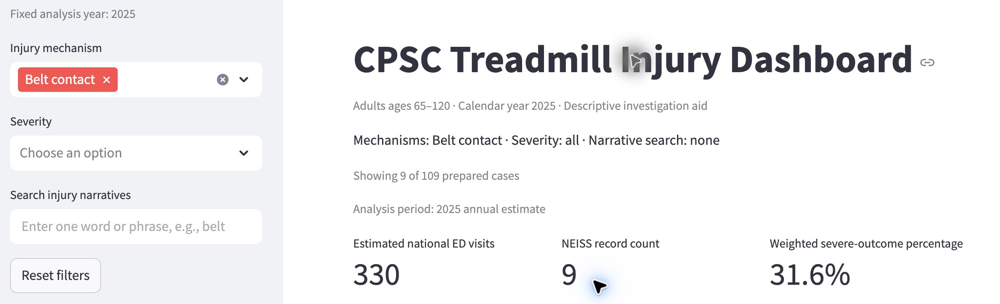
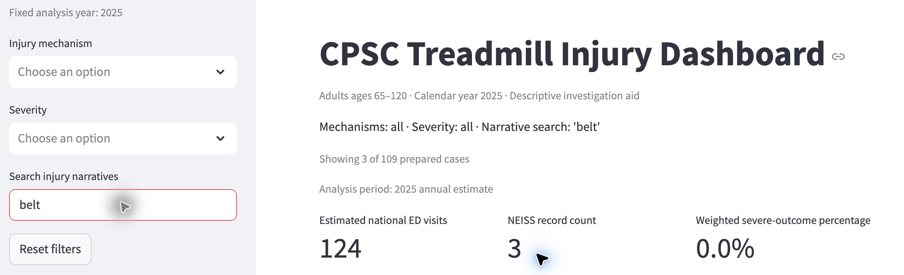

# Jordan Lee: Whether to Add Extra Treadmill Belt Inspections

Colby Messih | DSO 576 | HW11

Keep manufacturer-directed maintenance in place. Decide whether to add extra belt inspections using local equipment condition, service history and technician advice; this dashboard does not estimate the benefit of additional inspections. Its belt-related injury evidence can prompt questions, but cannot establish belt wear, equipment failure or the safest inspection interval.

## 1. The person and the decision

Jordan Lee is a hypothetical operations manager at a community gym serving older adults. Before planning next month's maintenance workload, Jordan must decide whether to add belt inspections beyond the gym's existing manufacturer-directed schedule. Extra checks consume staff time and equipment availability; overlooking a real maintenance issue could leave members exposed to a hazard. This is a maintenance-allocation decision, distinct from choosing a training program or a CPSC investigation priority.

## 2. Their real situation and alternatives

Precor's commercial maintenance guidance gives Jordan a concrete starting point: its monthly service schedule includes inspecting the running deck and belt, verifying the stop clip and testing functions; its quarterly schedule adds belt tension, tracking and alignment checks. The page also directs readers to the service manual for procedures. These are Precor-specific examples, not a universal schedule for every treadmill. Jordan needs the instructions for the gym's actual models. [Precor]

The meaningful alternative to this dashboard is model-specific guidance combined with local inspection records, usage/odometer information, incident reports and a qualified service technician's assessment. Precor describes technician testing, diagnostic reports and plans tailored to needs and budgets. These inputs can identify the gym's equipment condition; national injury summaries cannot. The app can add broader injury context but has no local maintenance history, inspection costs or measured inspection effect. [Precor]

CPSC describes NEISS as a hospital emergency-department surveillance system. It distinguishes injuries associated with a product from injuries caused by it, and explains that follow-back investigation can supply circumstances missing from brief records. Thus, national injury narratives are a prompt to investigate rather than a diagnosis of the gym's belts. [FAQ]

## 3. The app in use

Live app: https://treadmill-injury-dashboard.streamlit.app/. Genuine Chrome captures were taken November 7, 2026, Pacific time. The assistant operated the public app; no personal visit by Jordan or interview with a gym manager is claimed. The fixed cohort is ages 65-120 in calendar year 2025.

Start with all controls clear: 109 prepared visits, approximately 5,120 weighted ED visits and 22.3% weighted severe outcomes. Next select Belt contact, leave severity unrestricted and search blank. The headline becomes 9 records, 330 weighted visits and 31.6% severe outcomes. Finally reset filters and search belt with both selectors unrestricted: only 3 records, 124 weighted visits and 0.0% severe outcomes remain. The category and the literal word search select different populations.

## 4. Reading the result for the decision

Does the number measure what Jordan cares about? Only indirectly. The 31.6121% is 104.4551 severe weighted visits divided by 330.4278 selected weighted visits, multiplied by 100. It is not the probability of injury during a gym visit or the fraction preventable by inspection. Severe means recorded disposition 2, 4, 5 or 8. Two sampled severe visits support the numerator. The app counts ED burden and disposition; Jordan needs the marginal safety benefit of extra inspections (Module 11 kinds 3 and 4).

Who is in the rows, and who is not? One row represents an ED visit, not a unique user. The release retains 109 reviewed visits after screening the 2025 source for age 65-120, product 3277 and a literal treadmill mention; 79 of 188 candidates were excluded. Younger users, non-ED incidents, near misses, other years and cases outside those screening/review rules are absent. The displayed cohort is not restricted to Jordan's gym or commercial facilities (kinds 1, 2 and 5).

The codebook defines Belt contact to include initiating belt motion or sudden stops/surges; it does not certify worn components. For example, record 251030741 describes a wrong button causing acceleration, and 250333201 describes inadvertently increasing speed. Record 250614760 describes unexpected acceleration but does not establish its cause. Those narratives cannot tell Jordan how many injuries an inspection would prevent.

What outside the data matters? The actual treadmill model, belt condition, service findings, usage, local incidents and staff capacity could change the decision. None is linked to Jordan's equipment in this dataset. Model-specific maintenance guidance is directly actionable; CPSC surveillance cannot replace a local inspection. [Precor; FAQ]

What could Jordan wrongly conclude? A 31.6% severe share does not mean 31.6% of belt users are seriously injured, nor that worn belts caused those injuries (kind 6). It is based on only nine sampled visits. CPSC flags national estimates below 1,200, fewer than 20 cases, or CV above 33% as unstable; this subgroup fails the first two screens, and the app supplies no survey-design CV. These screens do not test whether inspection works (kind 9). [Estimates]

Searching belt is also not a substitute for selecting Belt contact. The search finds two Belt contact visits plus one Fall visit, while seven of the nine category visits lack that literal word. Its 0% severe outcome share cannot establish that belt-related hazards are harmless. filters.py applies a trimmed, case-insensitive literal search; views.py computes weight sums and the weighted severe ratio. An independent CSV/Decimal check below reproduces the live results.

| Selection | Records | Weighted visits | Severe records | Severe weight | Severe % |
|---|---:|---:|---:|---:|---:|
| All records | 109 | 5119.6280 | 24 | 1141.8206 | 22.3028 |
| Belt contact | 9 | 330.4278 | 2 | 104.4551 | 31.6121 |
| Search: belt | 3 | 123.7879 | 0 | 0 | 0.0000 |

## 5. The verdict: prove or break

Break for this decision. Jordan is better informed by the app about the kinds of reported injuries, but it cannot justify extra inspections over the existing schedule or determine an inspection interval. Keep model-specific maintenance as the baseline, review local equipment/service evidence and consult the technician before reallocating resources. Relative to a manual and local records, the app adds national context; relative to the app alone, those alternatives supply the equipment-specific evidence this decision needs.

Proposed change request - clarify mechanism, search and maintenance interpretation. Place a short explanation beside the mechanism selector and narrative search: Belt contact describes an initiating injury mechanism, including speed changes; it is not evidence of belt wear or a confirmed defect. Explain that keyword search matches text rather than mechanism labels, and make matching narratives available when a mechanism is selected even with a blank search. Retain existing filters, totals and baselines.

Acceptance check: selecting Belt contact with blank search exposes the nine matching narratives and the mechanism explanation. Clearing that category and searching belt still returns the existing three visits. No totals or classification rules change. This helps facility managers, investigators and other readers interpret mechanisms without conflating mentions with causes; it preserves Ryan's comparisons and Richard's training use case. This request is proposed here, not implemented or posted to the shared repository.

## Sources and evidence

- [Precor, Preventative Maintenance (Exhibit A: treadmill schedule)](https://www.precor.com/en-US/preventative-maintenance)
- [CPSC, NEISS Frequently Asked Questions](https://www.cpsc.gov/Research--Statistics/NEISS-Injury-Data/Neiss-Frequently-Asked-Questions)
- [CPSC, Explanation of NEISS Estimates](https://www.cpsc.gov/Research--Statistics/NEISS-Injury-Data/Explanation-Of-NEISS-Estimates-Obtained-Through-The-CPSC-Website)
- [CPSC Treadmill Injury Dashboard](https://treadmill-injury-dashboard.streamlit.app/)

Team code and released data: ryanyu808/project, commit e3eebd9, retrieved November 7, 2026. Data file: data/prepared/treadmill_2025.csv; definitions: data/prepared/mechanism-codebook.md, version 1.2; computation: filters.py and views.py. Independent check: check-jordan-numbers.py and number-check.json. Screenshots are authentic live-app captures, cropped only.

Scenario and initial draft were AI-assisted; Colby explicitly accepted the interpretation and break verdict in chat. No user interview, maintenance experiment or causal validation is claimed.

## Working notes

Person and decision selected by the assistant at Colby's request. Only Ryan's case was present in the retrieved team repo; Richard's claim was checked from the supplied group-chat screenshot. Other unposted teammate claims cannot be verified. Colby still needs to claim this case with the team. All five template parts retained; instructional placeholders and repeated prompts omitted. No files committed, pushed or submitted.
