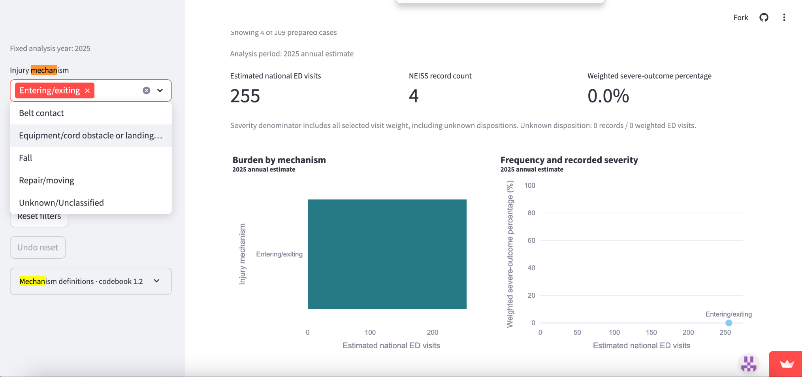
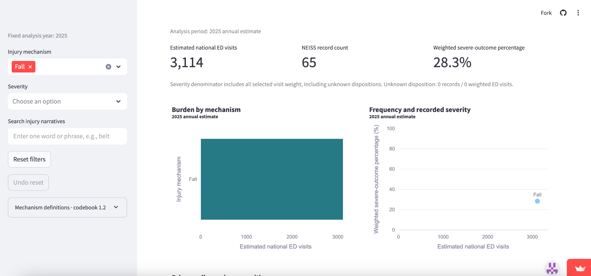

# CASE: EMILY CARTER — SUPERVISED TREADMILL REHABILITATION FOR OLDER ADULTS

## 1. The Person and the Decision

Emily Carter is a fictional physical therapist who works with adults aged 65 and older at an outpatient rehabilitation clinic.

Her decision is whether older adults beginning treadmill-based rehabilitation should receive supervised treadmill sessions instead of exercising independently.

Emily wants patients to improve their walking ability, endurance, and confidence while minimizing preventable injuries. She must balance patient safety, independence, and limited clinical staff time.

## 2. Their Real Situation and Alternatives

Physical therapists regularly evaluate walking ability, balance, mobility, and fall risk before recommending rehabilitation exercises.

The Centers for Disease Control and Prevention (CDC) recommends that older adults participate in aerobic, muscle-strengthening, and balance activities. The American Physical Therapy Association (APTA) also emphasizes individualized treatment plans and appropriate progression of rehabilitation activities.

Emily has three alternatives:

1. **Supervised treadmill rehabilitation:** A physical therapist monitors patients during their initial treadmill sessions and evaluates their balance, walking ability, and equipment use.
2. **Independent treadmill exercise:** Patients use treadmills without continuous supervision after an individual safety assessment.
3. **Alternative rehabilitation exercises:** Patients begin with supervised overground walking or balance exercises before progressing to treadmill use.

Emily needs to consider fall risk, physical ability, staff availability, and whether patients can safely use treadmill equipment.

The CDC's recommendations support physical activity for older adults, while APTA guidance emphasizes individualized care and appropriate progression. Neither source establishes that every older adult must receive supervised treadmill exercise.

**Sources:**

- Centers for Disease Control and Prevention. *Older Adult Activity: An Overview* (2025). https://www.cdc.gov/physical-activity-basics/guidelines/older-adults.html
- American Physical Therapy Association. *Documentation: Initial Examination and Evaluation*. https://www.apta.org/your-practice/documentation/defensible-documentation/elements-within-the-patientclient-management-model/initial-examination

## 3. The App in Use

**Live link:** https://treadmill-injury-dashboard.streamlit.app/

Emily opens the team's CPSC Treadmill Injury Dashboard to investigate treadmill-related emergency department injuries among older adults.

**What she selects:**

- Analysis year: 2025
- Age range: 65–120, fixed by the dashboard
- Injury mechanism: Entering/exiting
- Severity: All
- Narrative search: None

The dashboard displays:

- Estimated national emergency department visits: **255**
- NEISS injury records: **4**
- Weighted severe-outcome percentage: **0.0%**

Emily then changes the injury mechanism filter to **Fall**, leaving the other settings unchanged.

The dashboard displays:

- Estimated national emergency department visits: **3,114**
- NEISS injury records: **65**
- Weighted severe-outcome percentage: **28.3%**

The results show substantially more estimated emergency department visits classified as falls than as entering/exiting injuries.

The entering/exiting category is based on only four sampled records, making its 0.0% severe-outcome percentage particularly uncertain.

These figures help Emily understand documented injury patterns but do not directly measure whether supervision prevents treadmill injuries.

## 4. Reading the Result for Their Decision

**Does the number measure what this person cares about?**

Partially. Emily cares about preventing injuries during treadmill rehabilitation. The dashboard estimates national emergency department visits and reports injury severity, but it does not measure the effectiveness of supervised rehabilitation.

The dashboard reports 3,114 estimated fall-related emergency department visits, with a weighted severe-outcome percentage of 28.3%. These results suggest that falls deserve attention when evaluating treadmill safety.

However, they do not establish whether supervised rehabilitation would have prevented these injuries.

**Who is in the rows, and who is not?**

The dashboard analyzes 2025 NEISS records involving treadmill-related emergency department injuries among adults aged 65–120.

It does not include every treadmill user, every rehabilitation patient, or injuries that never resulted in an emergency department visit.

It also does not provide the total number of people using treadmills, their exercise exposure, or whether a physical therapist was present when an injury occurred.

Consequently, the dashboard cannot calculate an individual's probability of injury during supervised or independent rehabilitation.

**What outside the data matters to this decision?**

Emily must consider individual balance, mobility, medical history, walking ability, clinical assessment results, available staff, and the patient's rehabilitation goals.

CDC guidance emphasizes aerobic and balance activities for older adults. APTA guidance supports individualized treatment planning and reassessment as patients progress.

These considerations are necessary because national injury statistics cannot replace individual clinical evaluation.

**What could they wrongly conclude from it?**

Emily might incorrectly conclude that all older adults should be supervised on treadmills because fall-related injuries account for 3,114 estimated emergency department visits.

That conclusion would be unsupported because the dashboard does not compare supervised and unsupervised treadmill users.

She could also incorrectly conclude that entering and exiting treadmills presents no serious danger because the displayed severe-outcome percentage is 0.0%. That percentage comes from only four sampled records and should not be interpreted as proof of safety.

## 5. The Verdict: Prove or Break

**Verdict: Break — the dashboard is useful supporting evidence but is insufficient for Emily's supervision decision.**

The dashboard helps Emily identify treadmill-related injury mechanisms and understand the potential severity of falls among older adults.

It is more useful than relying entirely on assumptions about treadmill injuries because it provides numerical evidence from a national injury surveillance system.

However, it cannot determine whether supervised rehabilitation is safer than independent treadmill exercise. It lacks supervision status, rehabilitation context, exposure data, and patient-specific clinical information.

Emily should use the dashboard to inform safety discussions, but her final decision should rely on individual patient assessments and professional rehabilitation guidance.

**Change Request: Add a Rehabilitation Decision-Support Explanation**

The dashboard should include an interpretation panel explaining:

1. The difference between emergency department injury estimates and an individual's risk of injury.
2. That the data cannot establish whether supervision prevents treadmill injuries.
3. That injury categories with small record counts require caution.
4. That rehabilitation decisions should incorporate individual clinical assessments and external professional guidance.

This improvement would help rehabilitation professionals and other users interpret the dashboard responsibly without changing the underlying injury calculations.

**Final conclusion:** Emily is better informed by using the dashboard alongside clinical assessments and professional guidance than by using the dashboard alone. The app is valuable for understanding injury patterns, but it should not determine individual rehabilitation supervision requirements.

