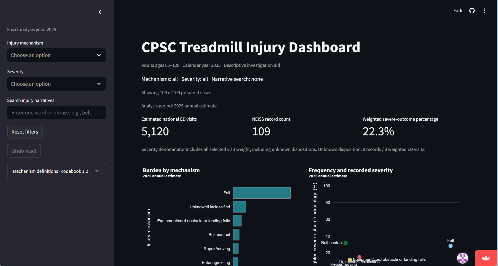
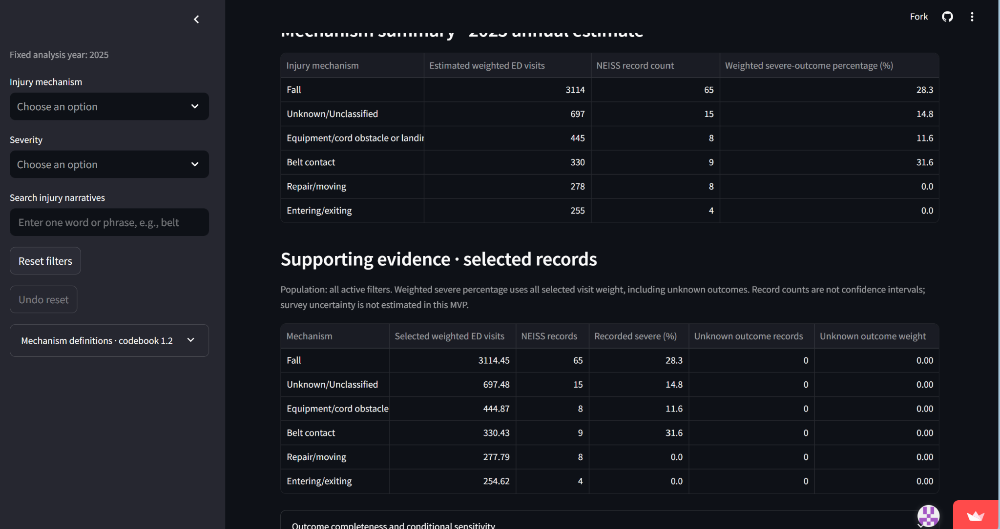
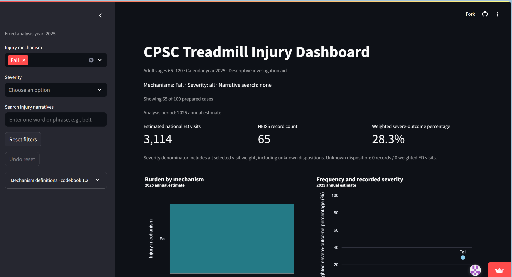
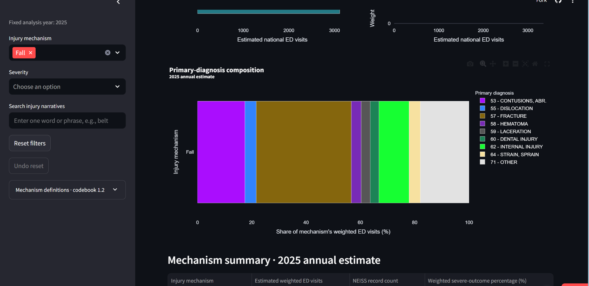
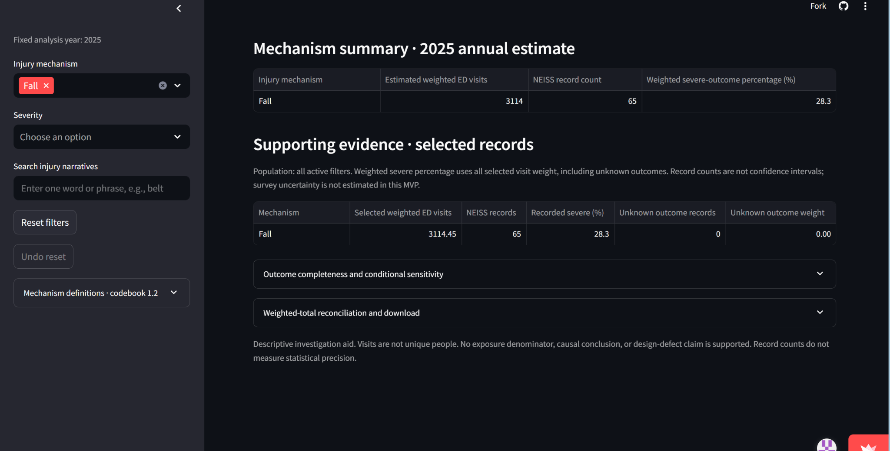

# Case: Alex Morgan — Should a Hospital Prioritize Treadmill-Fracture Education at Discharge?

*DSO 576 | Module 11 | Individual Case — Treadmill Injury Dashboard*

*Persona disclosure: Alex Morgan is a hypothetical hospital injury-prevention coordinator, not an actual interview subject. This case tests one plausible decision using published clinical guidance and the team's live app.*

## 1. The person and the decision

Alex Morgan coordinates injury-prevention education at a community hospital serving older adults. Before the next update of discharge materials in November 2026, Alex must decide **whether to add a treadmill-specific fracture safety section for adults aged 65+**, or keep scarce teaching time focused on existing, broader fall-prevention guidance. An inappropriate choice could omit a relevant risk or divert patients' and clinicians' attention from more useful measures.

## 2. Their real situation and alternatives

The CDC's **STEADI inpatient-care guidance** describes integrating fall-prevention practices into hospital workflows and supporting older adults after discharge [1]. The CDC also emphasizes that hip fractures can have major consequences for older adults and recommends assessing fall risk, medicines and the home environment [2]. These sources make **clinical relevance, patient comprehension and actionable advice** more important to Alex than a high national injury count alone.

Alex's alternatives are to use CDC STEADI materials, examine the hospital's own older-adult fall/fracture and discharge records, and consult nurses, rehabilitation specialists and clinical educators. The CPSC says **NEISS is a sample of U.S. emergency departments** and estimates injuries *associated with*, not necessarily *caused by*, consumer products [3]. The team's dashboard can reveal patterns worth discussing, but cannot show local patient exposure to treadmills, whether discharge instructions prevent injuries, or the cost and staffing implications of adding content.

**Sources used**

1. Centers for Disease Control and Prevention (CDC), *Inpatient Care — STEADI* (2025): https://www.cdc.gov/steadi/hcp/clinical-resources/inpatient-care.html
2. Centers for Disease Control and Prevention (CDC), *Preventing Falls and Hip Fractures* (2026): https://www.cdc.gov/falls/prevention/
3. U.S. Consumer Product Safety Commission (CPSC), *NEISS Frequently Asked Questions*: https://www.cpsc.gov/Research--Statistics/NEISS-Injury-Data/Neiss-Frequently-Asked-Questions
4. Treadmill Injury Dashboard team, *Reviewed 2025 Production Results* (independent validation, November 5, 2026): https://github.com/ryanyu808/project/blob/main/validation/REAL_DATA_RESULTS.md

## 3. The app in use

**Live app:** https://treadmill-injury-dashboard.streamlit.app/

**Workflow.** Alex opens the public live dashboard for **2025**, adults **65–120**. First Alex keeps **Injury mechanism = all; Severity = all; Narrative search = blank** to establish the overall baseline and compare mechanisms. Alex then changes **Injury mechanism to `Fall`** while keeping Severity unfiltered and Narrative search blank, to examine falls and fracture diagnoses more closely. All five screenshots were captured from the team's live app, not a local copy.

**Screen 1 — Overall baseline, all filters cleared.** The dashboard reports **109 retained NEISS records**, **5,120 estimated national ED visits**, and **22.3% weighted severe outcomes**. These are sample records, estimated visits, and a conditional outcome percentage respectively; they are not interchangeable.



**Screen 2 — Compare mechanisms before filtering.** The unfiltered mechanism and evidence tables report `Fall` as **65 records / 3,114.45 weighted visits / 28.3% recorded severe outcomes**. Other mechanisms remain distinct: equipment/cord obstacle or landing falls **8 / 444.87**, belt contact **9 / 330.43**, and entering/exiting **4 / 254.62**. This is a useful comparison but not a per-user injury-rate ranking.



**Screen 3 — Select `Fall`.** The sidebar visibly shows **Injury mechanism = Fall**, with Severity still at all and the narrative search empty. The resulting cohort has **65 of 109 prepared sample records**, **3,114 estimated national ED visits**, and **28.3% weighted severe outcomes**. This confirms that Alex is now viewing only the app's `Fall` mechanism group, not every mechanism involving a fall.



**Screen 4 — Examine fracture diagnoses under `Fall`.** With `Fall` selected, the *Primary-diagnosis composition* chart includes a segment labeled **`57 - FRACTURE`**. Its width is approximately one-third of the weighted Fall visits. The chart screenshot has **no numeric hover tooltip**, so the precise value below comes from the independent validation report [4], not from visual estimation of the bar.



**Screen 5 — Check the evidence denominator.** The filtered *Mechanism summary* and *Supporting evidence* tables show **3,114.45 selected weighted visits**, **65 NEISS sample records**, **28.3% recorded severe outcomes**, and **zero unknown-outcome records**. The dashboard itself warns that visits are not unique people, no exposure denominator is available, and statistical precision is not estimated in this MVP.



**Independent arithmetic check.** The team's independent validation report [4] gives **1,092.5582 fracture-primary-diagnosis weighted visits** among **3,114.4453 `Fall` weighted visits**. Therefore the fracture share is `1,092.5582 / 3,114.4453 × 100 = 35.1%` (one decimal). It also reconciles the all-mechanism total to **109 records and 5,119.6280 weighted ED visits**, consistent with the live app's rounded **5,120** headline. This comparison checks the numerical result without claiming the app has measured patient-level risk.

## 4. Reading the result for their decision

**Does the number measure what this person cares about?** **Only partly.** The validated **35.1%** is the share of weighted `Fall`-mechanism **ED visits** with a primary fracture diagnosis, **not** a 35.1% chance that a treadmill user will fracture a bone. It also does not quantify how many fracture injuries a discharge handout could prevent. The `Fall`-filtered dashboard directly confirms **28.3% recorded severe outcomes** and **65 underlying records**. The severity metric is based on recorded ED dispositions, not fracture severity or long-term disability. The right denominator for the 35.1% figure is **all weighted `Fall` ED visits (3,114.4453)**, not all people using treadmills.

**Who is in the rows, and who is not?** The dashboard uses **109 retained sample records** of 2025 treadmill-related ED presentations involving adults aged 65–120, selected after the team's review of **188 candidates** (**79 excluded**) [4]. With `Fall` selected, the app visibly narrows this to **65 records**, and the filtered evidence table shows **zero unknown dispositions**. It does not represent all treadmill users, all uninjured exposures, non-ED care, or patients at Alex's own hospital. The weighted national estimates are not 5,120 separately observed patients, and the `Fall` diagnosis pattern rests on **65 sample records**, without a reported confidence interval.

**What outside the data matters?** Alex would still need the hospital's actual discharge population and local injury history, patients' mobility and treadmill use, clinician-approved advice, and evidence-based post-discharge fall-prevention practices [1, 2]. CPSC surveillance is useful for identifying possible hazards but does not by itself establish the product's causal role or a successful prevention intervention [3].

**What could Alex wrongly conclude?** One error would be to treat **35.1%** as a per-user fracture probability, leading to exaggerated treadmill-specific warnings. Another would be to treat `Fall` as **all** treadmill falls: the dashboard also lists separate entering/exiting, belt-contact and equipment/cord mechanisms. Either misunderstanding could divert limited teaching time from more evidence-based, patient-specific fall prevention.

**Reproducible arithmetic check based on source [4]** (not a fresh live-data extraction):

```python
fracture_weight = 1092.5582
fall_weight = 3114.4453
print(f"{100 * fracture_weight / fall_weight:.1f}%")
# 35.1%
```

## 5. The verdict: prove or break

**Verdict — Break for the decision, retain as an investigative aid.** The app is better than no structured national surveillance view: it makes the selected injury patterns, sample sizes and severe-outcome definitions visible. **It is not sufficient to decide whether this hospital should prioritize a treadmill-fracture discharge section.** Alex should use it to propose questions for local data review, then compare the answer with STEADI practices and the hospital's own patients. Do **not** use it as a patient-level risk calculator, evidence of treadmill causation, or proof that a handout will reduce fractures.

**Change request (useful to other users too).** Add an optional **Primary diagnosis** filter (e.g., `Fracture`) so clinical educators and investigators can view fracture-coded ED visits **across all injury mechanisms**, with explicit weighted ED visit totals, NEISS record counts and active filters. Keep the current unfiltered view as the default. This expands diagnosis-focused comparisons without weakening the existing mechanism view.

**Acceptance check:** The optional `Primary diagnosis` multiselect must preserve the all-diagnosis default, display active filters, selected weighted visits and NEISS counts, map `Fracture` to diagnosis code 57, and restore **109 records / 5,119.6280 weighted visits** when cleared.

