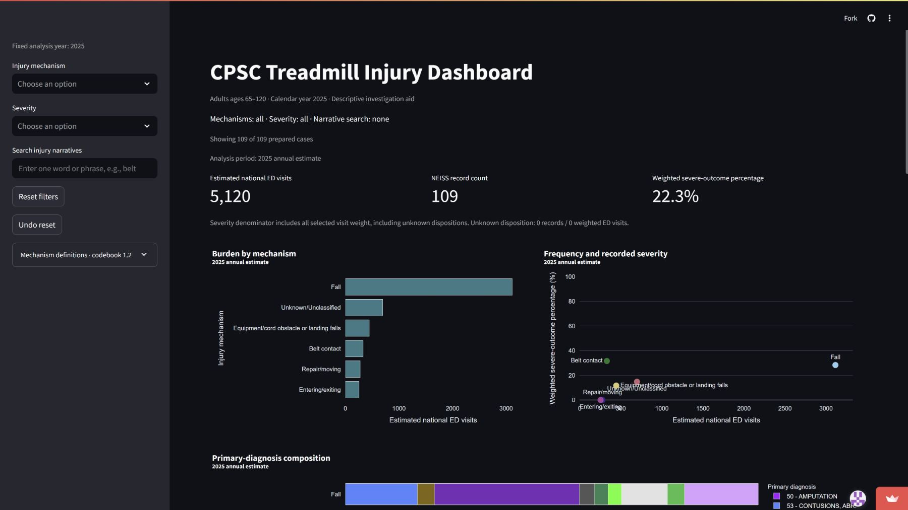
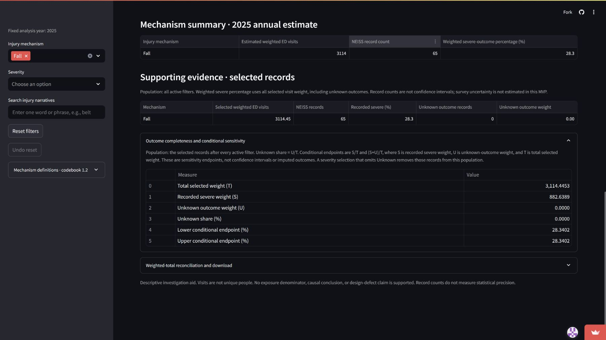
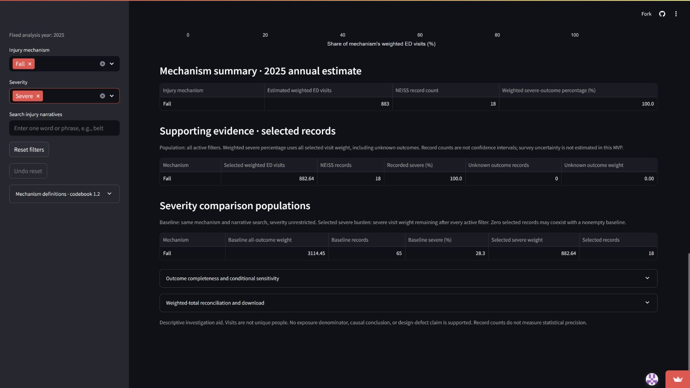
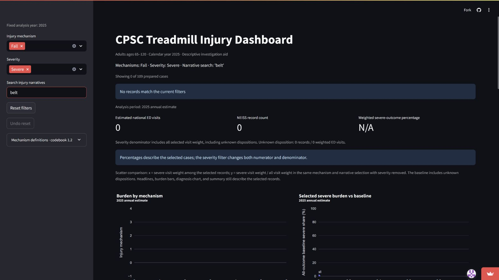
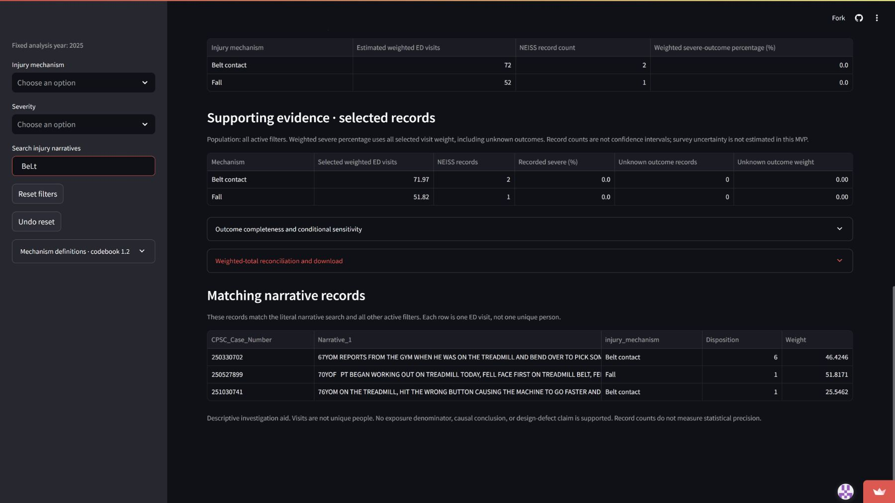

# Alex: should older-adult treadmill falls receive investigation priority?

**Ryan Yu's HW11 case - verified public evidence, November 5, 2026 (Pacific).** Ryan explicitly accepted the break conclusion in chat. The assistant operated and captured the live app; this is a researched fictional-person scenario, not an interview or an observed CPSC user study.

## 1. The person and the decision

Alex is a fictional CPSC epidemiology analyst, not someone interviewed. During investigation planning, Alex decides whether treadmill-related falls among adults 65 and older merit priority over other treadmill mechanisms for follow-up. A poor choice could divert limited investigative attention from a more consequential or informative pattern. The dashboard offers descriptive screening evidence, not a prescribed CPSC ranking rule.

## 2. Their real situation and alternatives

The CPSC [NEISS Frequently Asked Questions](https://www.cpsc.gov/Research--Statistics/NEISS-Injury-Data/Neiss-Frequently-Asked-Questions) describes screening surveillance data and follow-back investigation for additional circumstances. That supports the plausibility of Alex's role. It does not establish that CPSC uses this dashboard, that Alex is a real employee, or that burden alone sets priorities. Product association in an ED record does not prove that the product caused the injury.

The official [NEISS Estimates Query Builder instructions](https://www.cpsc.gov/Research--Statistics/NEISS-Injury-Data/Instructions-for-Using-the-NEISS-Estimates-Query-Builder) document filters, records and optional coefficient-of-variation/confidence-interval outputs. That is one alternative, alongside a reconciled spreadsheet/script. Its broader product query is not automatically our narrative-screened, human-classified cohort. CPSC's [Explanation of NEISS Estimates](https://www.cpsc.gov/Research--Statistics/NEISS-Injury-Data/Explanation-Of-NEISS-Estimates-Obtained-Through-The-CPSC-Website) explains variability and estimate interpretation. Follow-back can add product/environment/medical circumstances absent from terse narratives. These tools complement our fast coordinated comparisons; they are not displaced by the app.

## 3. The app in use

**Live app:** [CPSC Treadmill Injury Dashboard](https://treadmill-injury-dashboard.streamlit.app/). The assistant opened it in a separate browser session without signing in, observed the public viewer interface, and exercised the controls. Genuine captures were made November 6, 2026 UTC (November 5 Pacific). No local app, reconstructed image or invented result is used. The live reconciliation displayed production SHA-256 c97b9ef421000d5a6e476a5e1598e16d6c8fde9ad20b5cd32d83c626480e985f.

Alex starts with all controls clear, compares mechanisms, then selects Fall and Severe to inspect a follow-up shortlist. Searching belt tests a difficult empty subset rather than hiding it. Finally, removing those two filters reveals what the literal search actually matches.

| Screen and exact selections | Observed public result and decision relevance |
| --- | --- |
| A: Fixed 2025; mechanism all; severity all; search blank | 5,120 weighted visits / 109 records / 22.3% severe. Fall: 65 / 3114.4453 / 28.340164%. Belt contact: 9 / 330.4278 / 31.612080%. Burden and severe share give different rankings. |
| B: Fall; severity all; search blank | 65 records / 3114.4453 weight; 18 severe / 882.6389 weight. Unknown weight zero; both conditional endpoints 28.340164%. This is outcome completeness, not sampling certainty. |
| C: Fall; Severe; search blank | Selected 18 / 882.6389 / 100%; comparison baseline 65 / 3114.4453 / 28.340164%. The table and diagnosis baseline prevent confusing these populations. |
| D: Fall; Severe; search belt | Zero records / zero weight / N/A with explicit empty result. An empty intersection is not absence of belt injuries overall. Reset then Undo restores all three selections. |
| E: Mechanism all; severity all; search BeLt with surrounding spaces | Three nonsevere records / 123.7879 weight. Matching IDs and original narratives expose which visits the literal, trimmed, case-insensitive search selected. |

**Public evidence figures A-E.** Captions identify the active controls; the original full captures are preserved unchanged. See the machine-readable capture manifest for exact UTC times and hashes.

The actual public download independently reconciles all six contributions and the selected-total row to 109 records and 5119.6280 weight, with matching period/scope/filters/data hash. The maximum float difference is 1E-12. Decimal computations, dashboard validators and configured local AppTest provide a different method from visually reading rounded values. Fall primary-fracture weight is 1092.5582, or 35.080346% of Fall weight. Evidence and reproducible commands are in validation/REAL_DATA_RESULTS.md and validation/results/public_export_check.json.

## 4. Reading the result for their decision

**Does the measure fit?** Fall has the greatest weighted burden of the six observed mutually exclusive categories: 3114.4453 of 5119.6280 weighted visits, supported by 65 of 109 sampled visits. Its 28.340164% severe share is above the all-cohort 22.302804%, but below Belt contact's 31.612080% from only nine records (two severe). Those descriptive contrasts are screening evidence; without survey-design uncertainty, they do not establish a stable difference. The app measures ED burden and recorded disposition, not preventability, investigation value or risk per user (kinds 3, 4 and 9 in Module 11).

The [CPSC estimate guidance](https://www.cpsc.gov/Research--Statistics/NEISS-Injury-Data/Explanation-Of-NEISS-Estimates-Obtained-Through-The-CPSC-Website) flags national estimates below 1,200, fewer than 20 cases, or CV above 33% as unstable. Every observed non-Fall mechanism is below the first two thresholds. Fall's 65 records / 3114.4453 pass those two screens, but its CV is uncomputed, so stability is not certified. Its severe subset (18 / 882.6389) is also small. These are national-estimate reporting cautions, not a significance test for differences in severe percentages.

**Who is in the rows?** One row is one ED visit, not one unique person. The full annual source has 410,201 records / 25 original columns; 188 candidates satisfy age 65-120, product 3277 and literal treadmill mention. Ryan's accepted injury-focused policy and genuine review retain 109 and exclude 79, including medical-only or incidental unrelated episodes. Other ages, non-ED injuries, missing mentions, other years and reviewed exclusions are absent (kinds 1, 2 and 5). The codebook's Fall is not every fall-involving injury: mounting, initiating belt and equipment obstacle/landing mechanisms are separated. The eight equipment cases do not establish power/use status. A broader all-fall question requires deliberate cross-category narrative analysis, not summing every belt or mounting case automatically.

**What outside the data matters?** Exposure to treadmill use, baseline health, medical triggers, investigation feasibility, preventability and new incident information could change priority. Neither the app nor these brief records supplies a causal comparison or usage denominator (kinds 7 and 8). Fractures contribute 35.080346% of Fall weight, which supports asking about clinical consequences in follow-up; it does not identify a design defect. A count is not statistical precision. The official uncertainty-capable tools and follow-back are essential complements.

**What could Alex misread?** The Fall + Severe headline is 100% because the selected denominator contains only severe visits; its explicit baseline remains 28.340164% (kind 6). The empty Fall + Severe + belt subset cannot show belt events never occur. All-cohort belt search actually returns three nonsevere records / 123.7879 weight. Outcome unknown weight is zero here, so the two endpoints coincide, but this does not eliminate sampling or eligibility uncertainty. Code 57 is the primary fracture bucket only, not every diagnosis. None of these figures measures injury probability per treadmill user.

## 5. The verdict: prove or break

**Ryan's accepted verdict: break.** Fall's 65 records and 3114.4453 weighted visits support a follow-up shortlist. Belt contact's 31.612080% severe share from nine records, compared with Fall's 28.340164%, does not establish a reliable ranking. Use the app to assemble questions and inspect evidence, not to declare a unique winner, causal defect, or exposure-adjusted risk.

The coordinated baselines, original matching records and exact reconciliation reduce comparison work relative to repeatedly reconciling a spreadsheet. The official query offers uncertainty outputs; follow-back supplies circumstances missing from narratives; separate analysis can examine broader fall-involving events. The app is a useful screening companion, but it is not yet as good as it gets for Alex. Clearer CPSC stability/uncertainty context belongs beside the scatter for all mechanisms. This also helps other users avoid interpreting small-group percentage differences as a precise ranking, without changing their numbers or imposing a case-specific rule.

Ryan explicitly answered "Accept this break conclusion" in chat. This owns the interpretation above; the captures were performed by the assistant, and no analyst interview or personal browser action by Ryan is claimed. The following request is recorded in change-requests.md and remains open:

### CR-09: Put estimate stability and uncertainty context beside the scatter

- **From:** Ryan Yu, 2026-11-05; explicitly accepted the HW11 break conclusion in chat.
- **Part:** Frequency-severity scatter and interpretation of mechanism comparisons.
- **Evidence:** Genuine public 2025 app: Fall has 65 records / 3114.4453 weighted visits / 28.340164% severe; Belt contact has nine records / 330.4278 weighted visits / 31.612080% severe, from two severe records. CPSC flags national estimates below 1,200, fewer than 20 cases, or CV above 33% as unstable. Every observed non-Fall mechanism is below the first two screens; Fall passes those two but its CV is uncomputed. Its severe subset is also small (18 / 882.6389). These screens are not a significance test for differences in percentages. Screenshots and public CSV checks are in cases/screenshots and validation/results/public_dashboard_verification.json.
- **Change:** Place clear, sourced CPSC stability/uncertainty context adjacent to the scatter for all mechanisms. Explain that differences are descriptive and survey-design uncertainty is not estimated. If validated design-based intervals are later available, show them with their assumptions; do not use naive binomial intervals on weighted visits. Retain visible counts and baselines. Apply the explanation consistently across users and filters, without declaring significance or automatically ranking priorities.
- **Priority:** medium
- **Status:** open
- **Acceptance:** Ryan's response was "Accept this break conclusion". This records his owned evaluation, not a new user study or an implemented feature. CR-02 already supplies counts/unknowns and a general caveat; this request adds sourced stability context at the point of scatter interpretation.
