# MVP validation

**Final strengthened release - November 9, 2026 Pacific.** Five distinct source-backed cases, authentic public-app figures, reviewed production data, independent numbers and the complete test suite are integrated below. The revised Unlisted five-minute demo and dashboard were checked without signing in. [Watch the demo](https://www.youtube.com/watch?v=JEA_-Y34y4w).

This dashboard helps a CPSC epidemiology analyst prioritize questions about treadmill injury mechanisms among adults 65-120. It combines weighted ED burden, recorded severe outcomes, primary diagnoses and original narratives. The genuine 2025 cohort contains 109 approved visits from 188 screened candidates; 79 are excluded under Ryan's accepted injury-focused policy. The annual source has 410,201 records and 25 original fields. One row is one ED visit; no exposure-adjusted risk, causation or automatic priority is inferred.

## 1. Design

The CPSC [NEISS FAQ](https://www.cpsc.gov/Research--Statistics/NEISS-Injury-Data/Neiss-Frequently-Asked-Questions) describes surveillance estimates and follow-back investigation, and distinguishes product association from causation. This supports an investigation-screening use case. Our particular interface, role scenarios and prioritization workflow are design hypotheses; no interview, usability study or observed analyst adoption is claimed. Direct analyst/user corroboration of workflow and usefulness has not been established; source-backed scenarios and Ryan's evaluation are the available design evidence.

The intended decision is where to spend limited follow-up attention, rather than whether a product is defective. Burden and severe share answer different questions: estimated volume versus recorded outcomes among visits. Diagnosis and narratives add context; visible evidence and missing outcomes help prevent overreading a high percentage supported by few records. The following eight changes extend the professor's starting build and remain protected by automated tests.

| Change request | Implemented behavior and decision rationale |
| --- | --- |
| CR-01 | Selected severe burden alongside all-outcome severe share, retaining mechanism/search. Prevents a severe-only filter from flattening every nonempty percentage to 100%. |
| CR-02 | Visible mechanism record counts and unknown-disposition counts/weights. Makes evidence volume and missingness inspectable without inventing precision thresholds. |
| CR-03 | Primary-diagnosis baseline beside selected composition under severity filtering. Keeps clinical context from being silently redefined. |
| CR-04 | Matching IDs and original narratives after all active filters. Enables users to examine what a literal search actually selected. |
| CR-05 | Reset and session-specific Undo reset. Restores the complete prior mechanism/severity/search selection for comparison. |
| CR-06 | Unknown share and none/all-unknown-severe endpoints. Shows the decision impact of missing outcomes without imputing values. |
| CR-07 | In-app mechanism definitions, version and initiating-event precedence. Makes taxonomy interpretation visible. |
| CR-08 | Full-precision contribution reconciliation and CSV with filter/period/data hash. Explains display rounding and supports independent audit. |

The team deliberately did not build exposure-adjusted risk, geographic/brand attribution, prediction, causal defect detection, significance claims or automatic investigation recommendations. The data and design do not support them. Source period is fixed to 2025; year-range controls and trends would require additional agreed artifacts and sampling interpretation. Counts are not confidence intervals, and no design-based uncertainty is estimated.

Meaningful alternatives are the official [NEISS query builder](https://www.cpsc.gov/Research--Statistics/NEISS-Injury-Data/Instructions-for-Using-the-NEISS-Estimates-Query-Builder), an independent spreadsheet/script, and CPSC follow-back investigation. The official query provides selectable confidence intervals/CV and downloadable records; it does not automatically reproduce our narrative-screened, manually classified cohort. A separate analysis can explore broader fall-involving definitions but takes reconciliation work. Follow-back can supply circumstances absent from short narratives; this dashboard cannot replace it. A database or automated classifier does not supply missing narrative circumstances or evidence of usefulness. Small, precomputed flat files keep interactions in memory and avoid exposing preparation inputs.

Preparation, loading, filtering, aggregation and UI wiring remain separate. Source and candidate fingerprints bind a completed review to its exact export; the loader rejects missing, edited, incomplete or sample artifacts instead of silently displaying national estimates. The injury-focused policy narrows the original broader involvement contract. Ryan explicitly accepts the matching policy and confirms his case review. The policy document retains its original authorship/fingerprint, and the actual acceptance is preserved in private review documentation. His subsequent version 1.2 taxonomy clarification supersedes only the old mechanism-version reference; inclusion scope and the original prompt are not silently changed. All records and taxonomy boundaries require real human verification; AI agreement does not satisfy that gate.

Public evidence appears in Cases, with visible controls and recorded capture times. Ryan's original Break verdict and CR-09 are preserved as the historical case evaluation. CR-09's implementation response is now verified separately in the November 9 release-response subsection. No independent analyst interview, usability experiment or observed adoption is claimed.

The accepted 1.2 clarification replaces a use-status assumption with Equipment/cord obstacle or landing falls. It describes eight equipment-relationship cases without asserting non-use, motor state or the initial cause of imbalance. Operating/on-from-supporting-surface falls remain Fall; more specific initiating mechanisms retain precedence. The four final mappings were explicitly authorized in Ryan's FINAL RELEASE message. The original 171 approvals and their later personal confirmation are preserved; no additional independent inspection is claimed. All 188 reviews now satisfy the unchanged source-bound guards. Earlier codebook versions and source/AI fields are preserved.

### Design decisions traced to users and evidence

Our primary task is to choose follow-up questions, not establish defects or a clinical policy. A useful output is a shortlist with the reason for selection, records to inspect and evidence still needed. Alex can carry the 18 severe Fall records into follow-up because Fall combines the largest observed burden with documented consequential outcomes; the app does not claim these are 18 unique people or prove Fall dominates every investigation criterion.

| User need and source | Implemented response | Demonstrated decision benefit and tradeoff |
| --- | --- | --- |
| CPSC analyst: screening and follow-back, described in the NEISS FAQ | Mechanism burden, outcome comparison and browsable original narratives | Select Fall/Severe, inspect all 18 visits and formulate circumstance questions; one view replaces repeated spreadsheet selection/reconciliation. Classification does not establish causation. |
| Small groups can produce unreliable estimates (CPSC Explanation of NEISS Estimates) | CR-09: sourced guidance directly beside the scatter, expandable mechanism-specific count/estimate screens, explicit uncomputed CV | Belt's nine records and 330.4278 weight fail both observable screens; Fall's 65/3114.4453 pass those screens but CV remains unknown. Prevents treating 31.6% versus 28.3% as a reliable rank. |
| Senior-center orientation depends on actual equipment and staff practice (Rockville, Acton, Precor) | CR-10: browse every selected narrative without guessing a keyword | Four entering/exiting narratives are inspectable together, rather than choosing between getting's three and got off's one; manufacturer guidance and local observations still determine the demonstration. |
| Facility manager needs model-specific maintenance (Precor preventative schedule) | Explain initiating mechanism versus belt wear; retain exact literal search and record IDs | Belt contact's nine and belt search's three are visibly different populations. Local belt condition and technician advice remain essential. |
| Clinical users need individual assessment (APTA initial examination; CDC STEADI) | Diagnosis composition, selected/all-outcome baselines, explicit ED-visit and disposition units | Describes clinical consequences for discussion without inferring supervision effectiveness, handout benefit or injury probability. |
| Every reader needs reproducible selection and arithmetic | Reset/Undo, exact population labels, full-precision contributions/CSV, source fingerprint | Restores a difficult empty intersection and reconciles 5119.6280 before display rounding; no evidence disappears when search is blank. |

Sources are linked and discussed in the respective cases below. Clinical supervision and maintenance-effect estimates were deliberately not added: exposure, intervention and local condition are absent. An optional diagnosis filter is deferred because the primary decision remains mechanism screening; the diagnosis composition and all-outcome baseline already supply its clinical context. A future filter must retain all-diagnosis defaults and redefine every selected/baseline/export population consistently, as James's open request specifies. Adding a selector without that validation would be misleading. Design-based intervals likewise require a validated survey estimator; our caution panel does not fabricate them.

These are design hypotheses supported by the documented tasks and sources, not a claim that a CPSC employee has adopted the app. The scenarios test plausible decisions using cited evidence; their limits remain explicit.

## 2. Cases

Five decisions cover investigation, facility operations, senior-center training, rehabilitation and hospital education. These are researched scenarios, not interviewed users. All authors' conclusions and proposed improvements are retained. Difficult cases include Ryan's empty intersection, Richard's getting/got off search mismatch, and decisions the surveillance data cannot settle. Similar first names do not mean duplicate decisions: the CPSC analyst Alex and hospital educator Alex Morgan have different roles and choices.

Attribution follows the case text and Git history. Richard is credited within the Sarah case, which Yiqi Rong uploaded; that discrepancy is reported rather than resolved by guessing authorship. Emily's file is attributed to Git contributor ps607. User confirmation that teammates completed their cases is the ownership basis; integration does not claim an independent interview or reapproval on their behalf.

Screenshots are retained byte-for-byte from the submitted public-app captures. Visible controls, displayed populations and figures were inspected against the released data; the original author statements identify their live origin. New November 9 public checks reproduce the same production hash and entering/exiting search behavior. Historical capture dates remain unchanged. Original individual Markdown/PDF files are preserved, including drafts; only the final versions below count as cases. Template guidance/comments are omitted from this combined presentation.

### Case 1: Analyst Alex: investigation priority

**Contribution:** Ryan Yu. **Source file:** `cases/ryan-treadmill-falls-final.md`.

**DSO 576 HW11 Case Study | Ryan Yu | November 5, 2026. This evaluation is based on verified public evidence and a researched analyst scenario, not an interview or observed CPSC user study.**

### 1. The person and the decision

Alex is a fictional CPSC epidemiology analyst, not someone interviewed. During investigation planning, Alex decides whether treadmill-related falls among adults 65 and older merit priority over other treadmill mechanisms for follow-up. A poor choice could divert limited investigative attention from a more consequential or informative pattern. The dashboard offers descriptive screening evidence, not a prescribed CPSC ranking rule.

### 2. Their real situation and alternatives

The CPSC [NEISS Frequently Asked Questions](https://www.cpsc.gov/Research--Statistics/NEISS-Injury-Data/Neiss-Frequently-Asked-Questions) describes screening surveillance data and follow-back investigation for additional circumstances. That supports the plausibility of Alex's role. It does not establish that CPSC uses this dashboard, that Alex is a real employee, or that burden alone sets priorities. Product association in an ED record does not prove that the product caused the injury.

The official [NEISS Estimates Query Builder instructions](https://www.cpsc.gov/Research--Statistics/NEISS-Injury-Data/Instructions-for-Using-the-NEISS-Estimates-Query-Builder) document filters, records and optional coefficient-of-variation/confidence-interval outputs. That is one alternative, alongside a reconciled spreadsheet/script. Its broader product query is not automatically our narrative-screened, human-classified cohort. CPSC's [Explanation of NEISS Estimates](https://www.cpsc.gov/Research--Statistics/NEISS-Injury-Data/Explanation-Of-NEISS-Estimates-Obtained-Through-The-CPSC-Website) explains variability and estimate interpretation. Follow-back can add product/environment/medical circumstances absent from terse narratives. These tools complement our fast coordinated comparisons; they are not displaced by the app.

### 3. The app in use

**Live app:** [CPSC Treadmill Injury Dashboard](https://treadmill-injury-dashboard.streamlit.app/). The public app was accessed without signing in; its viewer interface and controls were exercised, and authentic screenshots were captured November 6, 2026 UTC (November 5 Pacific). No local app, reconstructed image or invented result is used. The live reconciliation displayed production SHA-256 c97b9ef421000d5a6e476a5e1598e16d6c8fde9ad20b5cd32d83c626480e985f.

Alex starts with all controls clear, compares mechanisms, then selects Fall and Severe to inspect a follow-up shortlist. Searching belt tests a difficult empty subset rather than hiding it. Finally, removing those two filters reveals what the literal search actually matches.

| Screen and exact selections | Observed public result and decision relevance |
| --- | --- |
| A: Fixed 2025; mechanism all; severity all; search blank | 5,120 weighted visits / 109 records / 22.3% severe. Fall: 65 / 3114.4453 / 28.340164%. Belt contact: 9 / 330.4278 / 31.612080%. Burden and severe share give different rankings. |
| B: Fall; severity all; search blank | 65 records / 3114.4453 weight; 18 severe / 882.6389 weight. Unknown weight zero; both conditional endpoints 28.340164%. This is outcome completeness, not sampling certainty. |
| C: Fall; Severe; search blank | Selected 18 / 882.6389 / 100%; comparison baseline 65 / 3114.4453 / 28.340164%. The table and diagnosis baseline prevent confusing these populations. |
| D: Fall; Severe; search belt | Zero records / zero weight / N/A with explicit empty result. An empty intersection is not absence of belt injuries overall. Reset then Undo restores all three selections. |
| E: Mechanism all; severity all; search BeLt with surrounding spaces | Three nonsevere records / 123.7879 weight. Matching IDs and original narratives expose which visits the literal, trimmed, case-insensitive search selected. |

**Public evidence figures A-E.** Captions identify the active controls; the original full captures are preserved unchanged. See the machine-readable capture manifest for exact UTC times and hashes.


The actual public download independently reconciles all six contributions and the selected-total row to 109 records and 5119.6280 weight, with matching period/scope/filters/data hash. The maximum float difference is 1E-12. Decimal computations, dashboard validators and configured local AppTest provide a different method from visually reading rounded values. Fall primary-fracture weight is 1092.5582, or 35.080346% of Fall weight. Evidence and reproducible commands are in validation/REAL_DATA_RESULTS.md and validation/results/public_export_check.json.

### 4. Reading the result for their decision

**Does the measure fit?** Fall has the greatest weighted burden of the six observed mutually exclusive categories: 3114.4453 of 5119.6280 weighted visits, supported by 65 of 109 sampled visits. Its 28.340164% severe share is above the all-cohort 22.302804%, but below Belt contact's 31.612080% from only nine records (two severe). Those descriptive contrasts are screening evidence; without survey-design uncertainty, they do not establish a stable difference. The app measures ED burden and recorded disposition, not preventability, investigation value or risk per user (kinds 3, 4 and 9 in Module 11).

The [CPSC estimate guidance](https://www.cpsc.gov/Research--Statistics/NEISS-Injury-Data/Explanation-Of-NEISS-Estimates-Obtained-Through-The-CPSC-Website) flags national estimates below 1,200, fewer than 20 cases, or CV above 33% as unstable. Every observed non-Fall mechanism is below the first two thresholds. Fall's 65 records / 3114.4453 pass those two screens, but its CV is uncomputed, so stability is not certified. Its severe subset (18 / 882.6389) is also small. These are national-estimate reporting cautions, not a significance test for differences in severe percentages.

**Who is in the rows?** One row is one ED visit, not one unique person. The full annual source has 410,201 records / 25 original columns; 188 candidates satisfy age 65-120, product 3277 and literal treadmill mention. Ryan's accepted injury-focused policy and genuine review retain 109 and exclude 79, including medical-only or incidental unrelated episodes. Other ages, non-ED injuries, missing mentions, other years and reviewed exclusions are absent (kinds 1, 2 and 5). The codebook's Fall is not every fall-involving injury: mounting, initiating belt and equipment obstacle/landing mechanisms are separated. The eight equipment cases do not establish power/use status. A broader all-fall question requires deliberate cross-category narrative analysis, not summing every belt or mounting case automatically.

**What outside the data matters?** Exposure to treadmill use, baseline health, medical triggers, investigation feasibility, preventability and new incident information could change priority. Neither the app nor these brief records supplies a causal comparison or usage denominator (kinds 7 and 8). Fractures contribute 35.080346% of Fall weight, which supports asking about clinical consequences in follow-up; it does not identify a design defect. A count is not statistical precision. The official uncertainty-capable tools and follow-back are essential complements.

**What could Alex misread?** The Fall + Severe headline is 100% because the selected denominator contains only severe visits; its explicit baseline remains 28.340164% (kind 6). The empty Fall + Severe + belt subset cannot show belt events never occur. All-cohort belt search actually returns three nonsevere records / 123.7879 weight. Outcome unknown weight is zero here, so the two endpoints coincide, but this does not eliminate sampling or eligibility uncertainty. Code 57 is the primary fracture bucket only, not every diagnosis. None of these figures measures injury probability per treadmill user.

### 5. The verdict: prove or break

**Ryan's accepted verdict: break.** Fall's 65 records and 3114.4453 weighted visits support a follow-up shortlist. Belt contact's 31.612080% severe share from nine records, compared with Fall's 28.340164%, does not establish a reliable ranking. Use the app to assemble questions and inspect evidence, not to declare a unique winner, causal defect, or exposure-adjusted risk.

The coordinated baselines, original matching records and exact reconciliation reduce comparison work relative to repeatedly reconciling a spreadsheet. The official query offers uncertainty outputs; follow-back supplies circumstances missing from narratives; separate analysis can examine broader fall-involving events. The app is a useful screening companion, but it is not yet as good as it gets for Alex. Clearer CPSC stability/uncertainty context belongs beside the scatter for all mechanisms. This also helps other users avoid interpreting small-group percentage differences as a precise ranking, without changing their numbers or imposing a case-specific rule.

This is Ryan's evaluation of the evidence; the captures were performed as part of the documented evidence workflow, and no analyst interview or personal browser action by Ryan is claimed. The following request is recorded in change-requests.md and remains open:

#### CR-09: Put estimate stability and uncertainty context beside the scatter

- **From:** Ryan Yu, 2026-11-05.
- **Part:** Frequency-severity scatter and interpretation of mechanism comparisons.
- **Evidence:** Genuine public 2025 app: Fall has 65 records / 3114.4453 weighted visits / 28.340164% severe; Belt contact has nine records / 330.4278 weighted visits / 31.612080% severe, from two severe records. CPSC flags national estimates below 1,200, fewer than 20 cases, or CV above 33% as unstable. Every observed non-Fall mechanism is below the first two screens; Fall passes those two but its CV is uncomputed. Its severe subset is also small (18 / 882.6389). These screens are not a significance test for differences in percentages. Screenshots and public CSV checks are in cases/screenshots and validation/results/public_dashboard_verification.json.
- **Change:** Place clear, sourced CPSC stability/uncertainty context adjacent to the scatter for all mechanisms. Explain that differences are descriptive and survey-design uncertainty is not estimated. If validated design-based intervals are later available, show them with their assumptions; do not use naive binomial intervals on weighted visits. Retain visible counts and baselines. Apply the explanation consistently across users and filters, without declaring significance or automatically ranking priorities.
- **Priority:** medium
- **Status:** open
- **Acceptance criterion:** CR-09 will be complete only when the released dashboard places sourced CPSC stability/uncertainty context beside the scatter for every mechanism and filter state, retains visible counts and baselines, explains that comparisons are descriptive and survey-design uncertainty is not estimated, and passes a documented live-app verification. Until then, its status remains open. CR-02 already supplies counts/unknowns and a general caveat; this request adds sourced stability context at the point of scatter interpretation.

#### Official sources

- [CPSC NEISS Frequently Asked Questions](https://www.cpsc.gov/Research--Statistics/NEISS-Injury-Data/Neiss-Frequently-Asked-Questions)
- [Instructions for Using the NEISS Estimates Query Builder](https://www.cpsc.gov/Research--Statistics/NEISS-Injury-Data/Instructions-for-Using-the-NEISS-Estimates-Query-Builder)
- [Explanation of NEISS Estimates](https://www.cpsc.gov/Research--Statistics/NEISS-Injury-Data/Explanation-Of-NEISS-Estimates-Obtained-Through-The-CPSC-Website)

### Case 2: Jordan Lee: extra belt inspections

**Contribution:** Colby Messih. **Source file:** `cases/colby-jordan-belt-inspections/jordan-belt-inspections-final.md`.

Colby Messih | DSO 576 | HW11

Keep manufacturer-directed maintenance in place. Decide whether to add extra belt inspections using local equipment condition, service history and technician advice; this dashboard does not estimate the benefit of additional inspections. Its belt-related injury evidence can prompt questions, but cannot establish belt wear, equipment failure or the safest inspection interval.

### 1. The person and the decision

Jordan Lee is a hypothetical operations manager at a community gym serving older adults. Before planning next month's maintenance workload, Jordan must decide whether to add belt inspections beyond the gym's existing manufacturer-directed schedule. Extra checks consume staff time and equipment availability; overlooking a real maintenance issue could leave members exposed to a hazard. This is a maintenance-allocation decision, distinct from choosing a training program or a CPSC investigation priority.

### 2. Their real situation and alternatives

Precor's commercial maintenance guidance gives Jordan a concrete starting point: its monthly service schedule includes inspecting the running deck and belt, verifying the stop clip and testing functions; its quarterly schedule adds belt tension, tracking and alignment checks. The page also directs readers to the service manual for procedures. These are Precor-specific examples, not a universal schedule for every treadmill. Jordan needs the instructions for the gym's actual models. [Precor]

The meaningful alternative to this dashboard is model-specific guidance combined with local inspection records, usage/odometer information, incident reports and a qualified service technician's assessment. Precor describes technician testing, diagnostic reports and plans tailored to needs and budgets. These inputs can identify the gym's equipment condition; national injury summaries cannot. The app can add broader injury context but has no local maintenance history, inspection costs or measured inspection effect. [Precor]

CPSC describes NEISS as a hospital emergency-department surveillance system. It distinguishes injuries associated with a product from injuries caused by it, and explains that follow-back investigation can supply circumstances missing from brief records. Thus, national injury narratives are a prompt to investigate rather than a diagnosis of the gym's belts. [FAQ]

### 3. The app in use

Live app: https://treadmill-injury-dashboard.streamlit.app/. Genuine Chrome captures were taken November 7, 2026, Pacific time. The assistant operated the public app; no personal visit by Jordan or interview with a gym manager is claimed. The fixed cohort is ages 65-120 in calendar year 2025.

Start with all controls clear: 109 prepared visits, approximately 5,120 weighted ED visits and 22.3% weighted severe outcomes. Next select Belt contact, leave severity unrestricted and search blank. The headline becomes 9 records, 330 weighted visits and 31.6% severe outcomes. Finally reset filters and search belt with both selectors unrestricted: only 3 records, 124 weighted visits and 0.0% severe outcomes remain. The category and the literal word search select different populations.

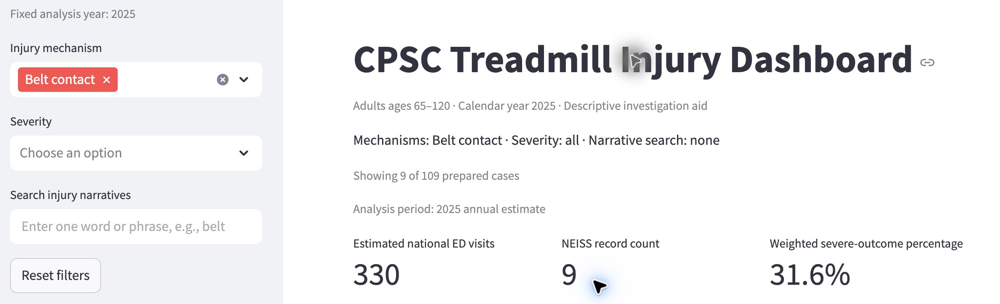

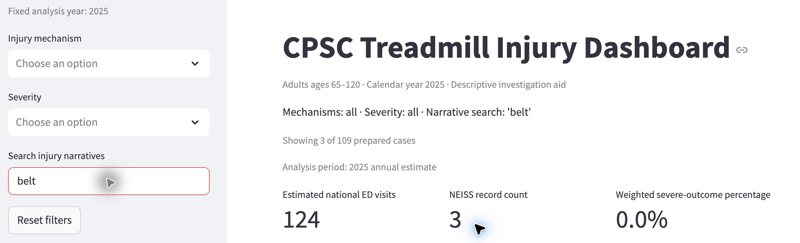

### 4. Reading the result for the decision

Does the number measure what Jordan cares about? Only indirectly. The 31.6121% is 104.4551 severe weighted visits divided by 330.4278 selected weighted visits, multiplied by 100. It is not the probability of injury during a gym visit or the fraction preventable by inspection. Severe means recorded disposition 2, 4, 5 or 8. Two sampled severe visits support the numerator. The app counts ED burden and disposition; Jordan needs the marginal safety benefit of extra inspections (Module 11 kinds 3 and 4).

Who is in the rows, and who is not? One row represents an ED visit, not a unique user. The release retains 109 reviewed visits after screening the 2025 source for age 65-120, product 3277 and a literal treadmill mention; 79 of 188 candidates were excluded. Younger users, non-ED incidents, near misses, other years and cases outside those screening/review rules are absent. The displayed cohort is not restricted to Jordan's gym or commercial facilities (kinds 1, 2 and 5).

The codebook defines Belt contact to include initiating belt motion or sudden stops/surges; it does not certify worn components. For example, record 251030741 describes a wrong button causing acceleration, and 250333201 describes inadvertently increasing speed. Record 250614760 describes unexpected acceleration but does not establish its cause. Those narratives cannot tell Jordan how many injuries an inspection would prevent.

What outside the data matters? The actual treadmill model, belt condition, service findings, usage, local incidents and staff capacity could change the decision. None is linked to Jordan's equipment in this dataset. Model-specific maintenance guidance is directly actionable; CPSC surveillance cannot replace a local inspection. [Precor; FAQ]

What could Jordan wrongly conclude? A 31.6% severe share does not mean 31.6% of belt users are seriously injured, nor that worn belts caused those injuries (kind 6). It is based on only nine sampled visits. CPSC flags national estimates below 1,200, fewer than 20 cases, or CV above 33% as unstable; this subgroup fails the first two screens, and the app supplies no survey-design CV. These screens do not test whether inspection works (kind 9). [Estimates]

Searching belt is also not a substitute for selecting Belt contact. The search finds two Belt contact visits plus one Fall visit, while seven of the nine category visits lack that literal word. Its 0% severe outcome share cannot establish that belt-related hazards are harmless. filters.py applies a trimmed, case-insensitive literal search; views.py computes weight sums and the weighted severe ratio. An independent CSV/Decimal check below reproduces the live results.

| Selection | Records | Weighted visits | Severe records | Severe weight | Severe % |
|---|---:|---:|---:|---:|---:|
| All records | 109 | 5119.6280 | 24 | 1141.8206 | 22.3028 |
| Belt contact | 9 | 330.4278 | 2 | 104.4551 | 31.6121 |
| Search: belt | 3 | 123.7879 | 0 | 0 | 0.0000 |

### 5. The verdict: prove or break

Break for this decision. Jordan is better informed by the app about the kinds of reported injuries, but it cannot justify extra inspections over the existing schedule or determine an inspection interval. Keep model-specific maintenance as the baseline, review local equipment/service evidence and consult the technician before reallocating resources. Relative to a manual and local records, the app adds national context; relative to the app alone, those alternatives supply the equipment-specific evidence this decision needs.

Proposed change request - clarify mechanism, search and maintenance interpretation. Place a short explanation beside the mechanism selector and narrative search: Belt contact describes an initiating injury mechanism, including speed changes; it is not evidence of belt wear or a confirmed defect. Explain that keyword search matches text rather than mechanism labels, and make matching narratives available when a mechanism is selected even with a blank search. Retain existing filters, totals and baselines.

Acceptance check: selecting Belt contact with blank search exposes the nine matching narratives and the mechanism explanation. Clearing that category and searching belt still returns the existing three visits. No totals or classification rules change. This helps facility managers, investigators and other readers interpret mechanisms without conflating mentions with causes; it preserves Ryan's comparisons and Richard's training use case. This request is proposed here, not implemented or posted to the shared repository.

### Sources and evidence

- [Precor, Preventative Maintenance (Exhibit A: treadmill schedule)](https://www.precor.com/en-US/preventative-maintenance)
- [CPSC, NEISS Frequently Asked Questions](https://www.cpsc.gov/Research--Statistics/NEISS-Injury-Data/Neiss-Frequently-Asked-Questions)
- [CPSC, Explanation of NEISS Estimates](https://www.cpsc.gov/Research--Statistics/NEISS-Injury-Data/Explanation-Of-NEISS-Estimates-Obtained-Through-The-CPSC-Website)
- [CPSC Treadmill Injury Dashboard](https://treadmill-injury-dashboard.streamlit.app/)

Team code and released data: ryanyu808/project, commit e3eebd9, retrieved November 7, 2026. Data file: data/prepared/treadmill_2025.csv; definitions: data/prepared/mechanism-codebook.md, version 1.2; computation: filters.py and views.py. Independent check: check-jordan-numbers.py and number-check.json. Screenshots are authentic live-app captures, cropped only.

Scenario and initial draft were AI-assisted; Colby explicitly accepted the interpretation and break verdict in chat. No user interview, maintenance experiment or causal validation is claimed.

### Case 3: Sarah Chen: senior-center orientation

**Contribution:** Richard (credited in case); uploaded by Yiqi Rong. **Source file:** `cases/case-sarah-treadmill-orientation.md`.

### 1. The person and the decision


Sarah Chen is a wellness program director at a community senior center where adults aged 65 and older use shared treadmills. Before the next new-member orientation, she must decide whether to add a brief, staff-led demonstration on how to safely get on and off a treadmill. If she makes the wrong decision, she could either overlook an important safety risk or waste limited staff time on unnecessary training. Sarah is a fictional character based on real senior center practices.

### 2. Their real situation and alternatives


Sarah's decision fits real fitness-room operations. The City of Rockville says its senior center has treadmills and certified fitness staff, and requires basic equipment training for new fitness members [1]. Acton Senior Center likewise requires an equipment orientation before gym use [2]. Thus, revising an orientation is a plausible choice, but the exact content, staffing cost, and injury experience at Sarah's fictional center are unknown.

The CDC's community fall-prevention compendium offers established program options, whereas equipment-specific instructions should come from the manual for her center's actual treadmill model [3, 4]. Precor's guide, for example, includes stepping onto the machine, clipping the safety key to clothing, and using the side rails [4]; its sequence is model-specific guidance, not evidence that every treadmill works identically.

Without this dashboard, Sarah could consult an equipment manual, ask her instructors to demonstrate safe use, examine the center's incident reports and member feedback, or compare documented fall-prevention programs. The dashboard adds a national emergency-department (ED) injury-pattern view, but cannot tell her how often members use treadmills, how many have fallen locally, how long a demonstration takes, or whether the demonstration prevents harm.

She would need local incident logs, observed practice, staffing estimates, and appropriate manufacturer instructions before imposing a costly policy.

**Sources:**

- City of Rockville, Classes and Programs at Rockville Senior Center: https://www.rockvillemd.gov/services/classes-and-programs-at-rockville-senior-center/

- Acton Senior Center, Exercise Information: https://actoncoa.com/161/Exercise-Information

- CDC, Falls Compendium: https://www.cdc.gov/falls/interventions/falls-compendium.html

- Precor, TRM 211 Treadmill Owner's Manual and Quick Start Guide: https://static.precor.com/precor-at-home/legacy/TRM_211_Manuals_103117_ENU.pdf
### 3. The app in use


**Live link:** https://treadmill-injury-dashboard.streamlit.app/

What they select:

Sarah uses the dashboard to examine treadmill-related injuries among adults aged 65 and older. The analysis year is fixed at 2025.

She first reviews the overall injury patterns, then selects the Entering/exiting mechanism to investigate injuries that occur when older adults get on or off treadmills. Finally, she uses the narrative search function to examine individual injury records.

Screen A: Overall injury patterns

Selections:

Injury mechanism: All

Severity: All

Narrative search: Blank

Year: 2025

What they see:

The dashboard displays 109 NEISS records, representing approximately 5,120 estimated national emergency department visits. The overall weighted severe-outcome percentage is 22.3%.

The mechanism chart shows different categories of treadmill-related injuries, including falls, belt contact, and entering/exiting incidents.

This overview helps Sarah identify which injury mechanisms may be relevant to her safety training program.

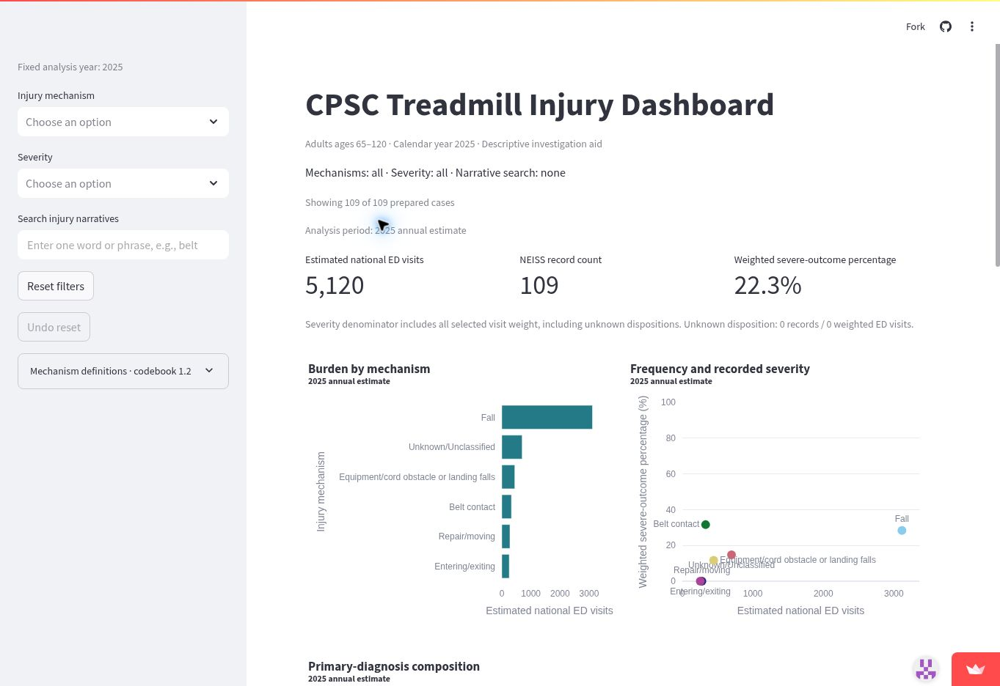

Screen B: Entering/exiting injuries

Selections:

Injury mechanism: Entering/exiting

Severity: All

Narrative search: Blank

What they see:

After selecting Entering/exiting, the dashboard displays four NEISS records, representing approximately 255 estimated national ED visits.

The weighted severe-outcome percentage is 0.0%, with no records classified as having severe outcomes.

This suggests that entering and exiting treadmills is a documented injury mechanism among older adults. However, the small sample means Sarah cannot conclude that these incidents are uncommon or harmless.

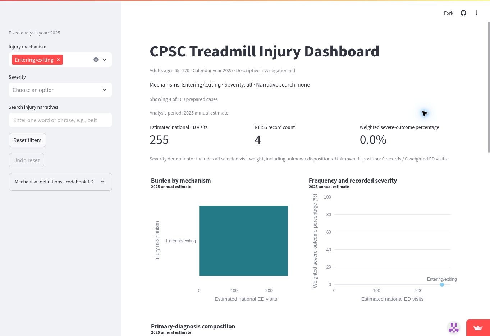

Screen C: Diagnosis composition

Selections:

Injury mechanism: Entering/exiting

Severity: All

Narrative search: Blank

What they see:

The diagnosis chart shows two primary diagnosis categories:

Contusions and abrasions: 79.49% of weighted ED visits.

Internal injuries: 20.51% of weighted ED visits.

The supporting evidence table confirms that these results come from only four NEISS records, with a total weight of 254.6187.

This information helps Sarah understand the types of injuries associated with getting on and off treadmills. However, these diagnosis proportions do not represent injury probabilities for treadmill users.

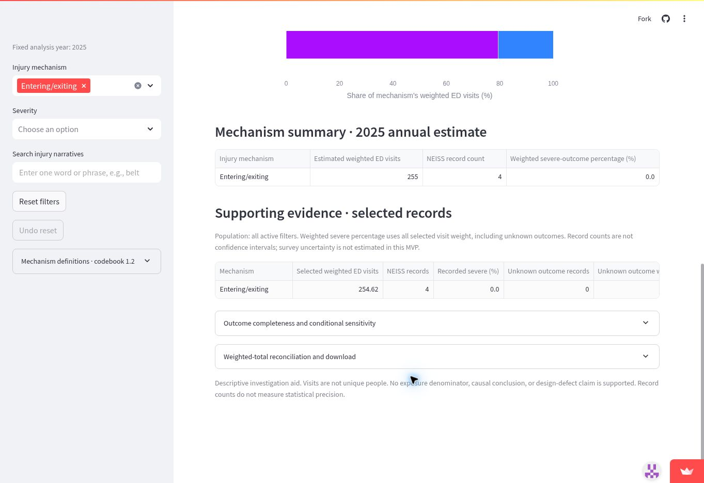

Screen D: Searching injury narratives

Selections:

Injury mechanism: Entering/exiting

Severity: All

Narrative search: getting

What they see:

When Sarah searches for "getting," the dashboard returns three injury records representing approximately 202.3912 weighted ED visits.

These records describe injuries associated with getting onto a treadmill.

However, Sarah notices that the search returns fewer records than the four shown in the original Entering/exiting category.

This suggests that the keyword search may not capture every relevant injury narrative.

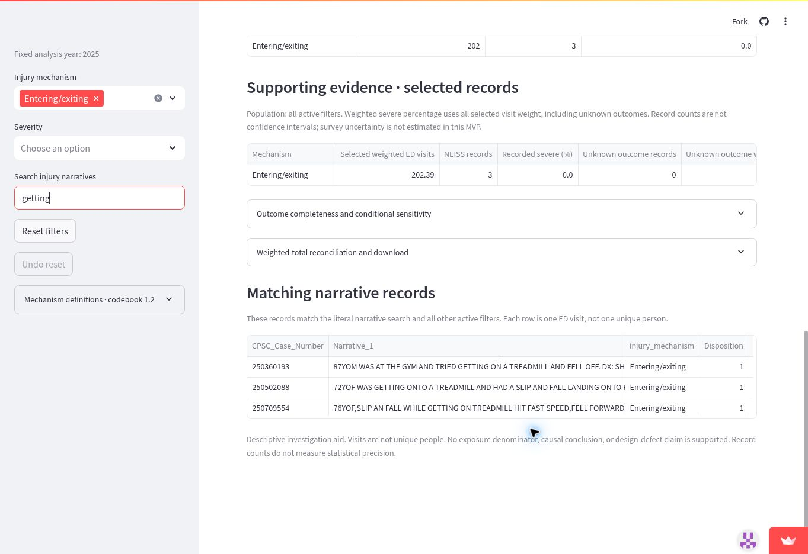

Screen E: Identifying a missing case

Selections:

Injury mechanism: Entering/exiting

Severity: All

Narrative search: got off

What they see:

After changing the search term to "got off," Sarah finds another injury record representing 52.2275 weighted ED visits.

This record describes a 77-year-old woman who slipped while getting off a treadmill and sustained a head injury.

The incident was not included in the previous "getting" search results.

This demonstrates an important limitation: the dashboard's narrative search relies on specific keywords, meaning users may overlook relevant cases if they do not search for the correct terms.

For Sarah, reviewing all entering/exiting injury narratives is important when deciding what safety instructions should be included in her training program.

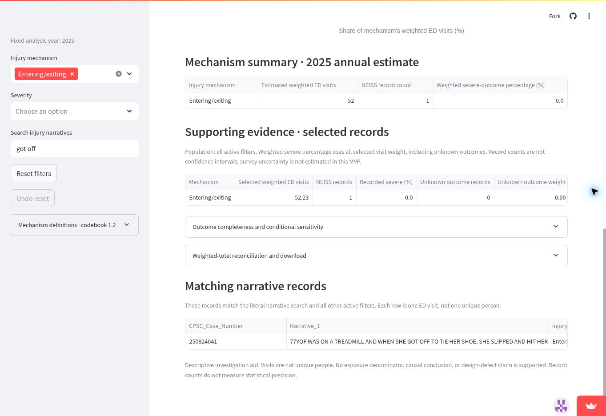

### 4. Reading the result for their decision


**Does the number measure what this person cares about?**
Only partially. The selected 254.6187 is the sum of NEISS survey weights for four sampled ED visits, not a center-specific injury rate or a probability per treadmill use (Module 11 kinds 3 and 4: stand-in versus target; total versus rate).

The app's 0.0% severe-outcome figure means none of the four records had one of the team's severe ED disposition codes (2, 4, 5, 8); it does not mean the events were harmless. One included dismounting record describes head impact and a head-injury diagnosis even though its disposition is not coded severe.

Compared with the overall cohort's 22.3028% weighted severe share (109 records), the difference does not establish that entering/exiting is safer because the subgroup contains only four records (kind 9: small groups/chance).

**Who is in the rows, and who is not?**
One row represents an ED visit, not a unique individual (kind 1). The team's prepared 2025 dataset contains 109 reviewed injury-related ED visits for adults ages 65-120, linked to treadmill product code 3277 and a narrative treadmill mention.

The team reviewed 188 screened candidates and excluded 79 under its accepted injury-focused policy. Within the selected Entering/exiting mechanism, the four records involve patients aged 72, 76, 77, and 87.

The dataset does not include treadmill users who did not visit a sampled emergency department, other years, or excluded records (kinds 2 and 5: membership and dates).

The dashboard's narrative search is literal rather than semantic. Searching "getting" returns three records, while "got off" identifies the fourth. Neither search alone represents the entire mechanism population.

**What outside the data matters to this decision?**
Sarah needs information about the center's actual treadmill models, existing safety training, participants' mobility limitations, staff availability, treadmill usage frequency, and previous local incidents.

CDC fall-prevention guidance, manufacturer instructions, and real senior-center practices provide useful alternatives [1-4]. According to CPSC, NEISS records describe product-associated injuries, not necessarily injuries caused by product defects [5].

The dashboard cannot establish whether a new orientation would prevent injuries, how much implementation would cost, or whether Sarah's members face the same risks as the national ED population.

**What could they wrongly conclude from it?**
Sarah might interpret the 0.0% severe-outcome rate as evidence that entering or exiting a treadmill poses no meaningful danger. However, one of the four records describes a head injury, demonstrating that a non-severe disposition does not necessarily mean an insignificant injury.

She might also interpret 255 weighted ED visits as a reliable national injury count or local incidence rate. CPSC considers national estimates potentially unstable when they are below 1,200, based on fewer than 20 sampled cases, or have a coefficient of variation above 33% [6]. This subgroup fails the first two criteria.

Finally, relying only on the three records returned by the search term "getting" would exclude the separate "got off" incident. These limitations mean the dashboard cannot independently prove that a new training program would prevent injuries.

**Independent release check:** all = 109 / 5119.6280; entering/exiting = 4 / 254.6187, zero severe; getting = 3 / 202.3912; got off = 1 / 52.2275; diagnosis 53 = 202.3912 and diagnosis 62 = 52.2275. The original example contains a mismatched closing bracket; the checked values are retained here.

### 5. The verdict: prove or break


The dashboard helps Sarah identify treadmill entering/exiting injuries and examine their frequency, severity, and diagnosis patterns. However, it cannot determine the actual injury risk at her senior center or prove that additional training would prevent injuries.

Sarah could reasonably introduce a short, staff-led demonstration on safely getting on and off treadmills, based on manufacturer guidance and staff observations. The dashboard would serve as supporting evidence rather than the sole justification for this decision.

Compared with alternatives such as manufacturer manuals, CDC guidance, and local incident reports, the dashboard provides useful national injury data. However, those alternatives remain essential for making a practical safety decision.


When Sarah selects Entering/exiting without entering a search term, the dashboard displays four injury records in its summary but does not show the corresponding narratives.

Searching "getting" returns only three records, while searching "got off" reveals a separate head-injury incident. Users must guess the correct keywords to find all relevant cases.

This could cause Sarah to overlook useful information when developing safety training.

The dashboard should allow users to view all injury narratives associated with their selected filters, even when no search keyword is entered.

This improvement would benefit other users, including researchers and safety program managers, by making the underlying evidence easier to inspect without changing the existing calculations.

Therefore, the dashboard is useful for identifying potential safety concerns but should not be used alone to make final safety-policy decisions.
#### CR-10: Allow users to browse all selected injury records

- **From:** Richard - HW11 Sarah Chen Case

- **Part:** Narrative search and record-level evidence

- **Evidence:** The live dashboard shows four
  Entering/exiting injury records with a total
  weighted estimate of 254.6187 ED visits.

  However, searching "getting" returns only
  three records (202.3912 weighted visits),
  while "got off" identifies the remaining
  record (52.2275 weighted visits).

- **Change:** Add an expandable table that displays
  all injury narratives matching the selected
  mechanism and severity filters, even when
  the narrative search field is empty.

- **Who benefits:** Researchers, safety managers,
  and other dashboard users who need to inspect
  the underlying records.

- **Why it does not hurt other users:** The change
  preserves existing filters, charts, calculations,
  and search functionality.

- **Priority:** Medium

- **Status:** Proposed / Not implemented

**Source-reference clarification for the integrated case:** [5] is the [CPSC NEISS FAQ](https://www.cpsc.gov/Research--Statistics/NEISS-Injury-Data/Neiss-Frequently-Asked-Questions); [6] is [CPSC Explanation of NEISS Estimates](https://www.cpsc.gov/Research--Statistics/NEISS-Injury-Data/Explanation-Of-NEISS-Estimates-Obtained-Through-The-CPSC-Website). These resolve the unlisted reference numbers in the original Sarah case without changing its conclusion.

### Case 4: Emily Carter: rehabilitation supervision

**Contribution:** ps607 (Git attribution). **Source file:** `cases/emily-carter-physical-therapy-case.md`.

### 1. The Person and the Decision

Emily Carter is a fictional physical therapist who works with adults aged 65 and older at an outpatient rehabilitation clinic.

Her decision is whether older adults beginning treadmill-based rehabilitation should receive supervised treadmill sessions instead of exercising independently.

Emily wants patients to improve their walking ability, endurance, and confidence while minimizing preventable injuries. She must balance patient safety, independence, and limited clinical staff time.

### 2. Their Real Situation and Alternatives

Physical therapists regularly evaluate walking ability, balance, mobility, and fall risk before recommending rehabilitation exercises.

The Centers for Disease Control and Prevention (CDC) recommends that older adults participate in aerobic, muscle-strengthening, and balance activities. The American Physical Therapy Association (APTA) also emphasizes individualized treatment plans and appropriate progression of rehabilitation activities.

Emily has three alternatives:

1. **Supervised treadmill rehabilitation:** A physical therapist monitors patients during their initial treadmill sessions and evaluates their balance, walking ability, and equipment use.
2. **Independent treadmill exercise:** Patients use treadmills without continuous supervision after an individual safety assessment.
3. **Alternative rehabilitation exercises:** Patients begin with supervised overground walking or balance exercises before progressing to treadmill use.

Emily needs to consider fall risk, physical ability, staff availability, and whether patients can safely use treadmill equipment.

The CDC's recommendations support physical activity for older adults, while APTA guidance emphasizes individualized care and appropriate progression. Neither source establishes that every older adult must receive supervised treadmill exercise.

**Sources:**

- Centers for Disease Control and Prevention. *Older Adult Activity: An Overview* (2025). https://www.cdc.gov/physical-activity-basics/guidelines/older-adults.html
- American Physical Therapy Association. *Documentation: Initial Examination and Evaluation*. https://www.apta.org/your-practice/documentation/defensible-documentation/elements-within-the-patientclient-management-model/initial-examination

### 3. The App in Use

**Live link:** https://treadmill-injury-dashboard.streamlit.app/

Emily opens the team's CPSC Treadmill Injury Dashboard to investigate treadmill-related emergency department injuries among older adults.

**What she selects:**

- Analysis year: 2025
- Age range: 65-120, fixed by the dashboard
- Injury mechanism: Entering/exiting
- Severity: All
- Narrative search: None

The dashboard displays:

- Estimated national emergency department visits: **255**
- NEISS injury records: **4**
- Weighted severe-outcome percentage: **0.0%**

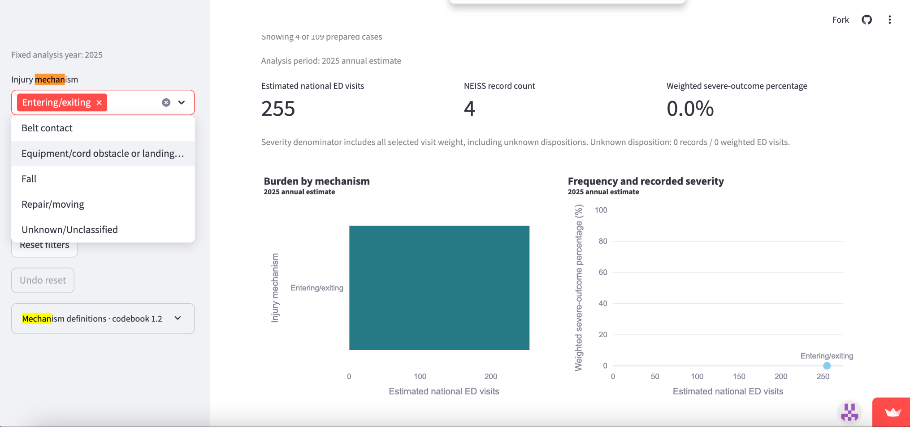

Emily then changes the injury mechanism filter to **Fall**, leaving the other settings unchanged.

The dashboard displays:

- Estimated national emergency department visits: **3,114**
- NEISS injury records: **65**
- Weighted severe-outcome percentage: **28.3%**

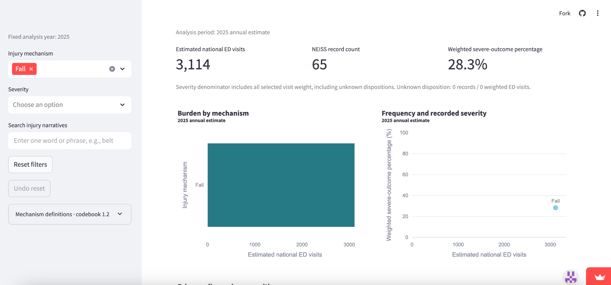

The results show substantially more estimated emergency department visits classified as falls than as entering/exiting injuries.

The entering/exiting category is based on only four sampled records, making its 0.0% severe-outcome percentage particularly uncertain.

These figures help Emily understand documented injury patterns but do not directly measure whether supervision prevents treadmill injuries.

### 4. Reading the Result for Their Decision

**Does the number measure what this person cares about?**

Partially. Emily cares about preventing injuries during treadmill rehabilitation. The dashboard estimates national emergency department visits and reports injury severity, but it does not measure the effectiveness of supervised rehabilitation.

The dashboard reports 3,114 estimated fall-related emergency department visits, with a weighted severe-outcome percentage of 28.3%. These results suggest that falls deserve attention when evaluating treadmill safety.

However, they do not establish whether supervised rehabilitation would have prevented these injuries.

**Who is in the rows, and who is not?**

The dashboard analyzes 2025 NEISS records involving treadmill-related emergency department injuries among adults aged 65-120.

It does not include every treadmill user, every rehabilitation patient, or injuries that never resulted in an emergency department visit.

It also does not provide the total number of people using treadmills, their exercise exposure, or whether a physical therapist was present when an injury occurred.

Consequently, the dashboard cannot calculate an individual's probability of injury during supervised or independent rehabilitation.

**What outside the data matters to this decision?**

Emily must consider individual balance, mobility, medical history, walking ability, clinical assessment results, available staff, and the patient's rehabilitation goals.

CDC guidance emphasizes aerobic and balance activities for older adults. APTA guidance supports individualized treatment planning and reassessment as patients progress.

These considerations are necessary because national injury statistics cannot replace individual clinical evaluation.

**What could they wrongly conclude from it?**

Emily might incorrectly conclude that all older adults should be supervised on treadmills because fall-related injuries account for 3,114 estimated emergency department visits.

That conclusion would be unsupported because the dashboard does not compare supervised and unsupervised treadmill users.

She could also incorrectly conclude that entering and exiting treadmills presents no serious danger because the displayed severe-outcome percentage is 0.0%. That percentage comes from only four sampled records and should not be interpreted as proof of safety.

### 5. The Verdict: Prove or Break

**Verdict: Break - the dashboard is useful supporting evidence but is insufficient for Emily's supervision decision.**

The dashboard helps Emily identify treadmill-related injury mechanisms and understand the potential severity of falls among older adults.

It is more useful than relying entirely on assumptions about treadmill injuries because it provides numerical evidence from a national injury surveillance system.

However, it cannot determine whether supervised rehabilitation is safer than independent treadmill exercise. It lacks supervision status, rehabilitation context, exposure data, and patient-specific clinical information.

Emily should use the dashboard to inform safety discussions, but her final decision should rely on individual patient assessments and professional rehabilitation guidance.

**Change Request: Add a Rehabilitation Decision-Support Explanation**

The dashboard should include an interpretation panel explaining:

1. The difference between emergency department injury estimates and an individual's risk of injury.
2. That the data cannot establish whether supervision prevents treadmill injuries.
3. That injury categories with small record counts require caution.
4. That rehabilitation decisions should incorporate individual clinical assessments and external professional guidance.

This improvement would help rehabilitation professionals and other users interpret the dashboard responsibly without changing the underlying injury calculations.

**Final conclusion:** Emily is better informed by using the dashboard alongside clinical assessments and professional guidance than by using the dashboard alone. The app is valuable for understanding injury patterns, but it should not determine individual rehabilitation supervision requirements.

### Case 5: Alex Morgan: hospital fracture education

**Contribution:** James Liao (Git attribution). **Source file:** `cases/hospital_fracture_education.md`.

*DSO 576 | Module 11 | Individual Case - Treadmill Injury Dashboard*

*Persona disclosure: Alex Morgan is a hypothetical hospital injury-prevention coordinator, not an actual interview subject. This case tests one plausible decision using published clinical guidance and the team's live app.*

### 1. The person and the decision

Alex Morgan coordinates injury-prevention education at a community hospital serving older adults. Before the next update of discharge materials in November 2026, Alex must decide **whether to add a treadmill-specific fracture safety section for adults aged 65+**, or keep scarce teaching time focused on existing, broader fall-prevention guidance. An inappropriate choice could omit a relevant risk or divert patients' and clinicians' attention from more useful measures.

### 2. Their real situation and alternatives

The CDC's **STEADI inpatient-care guidance** describes integrating fall-prevention practices into hospital workflows and supporting older adults after discharge [1]. The CDC also emphasizes that hip fractures can have major consequences for older adults and recommends assessing fall risk, medicines and the home environment [2]. These sources make **clinical relevance, patient comprehension and actionable advice** more important to Alex than a high national injury count alone.

Alex's alternatives are to use CDC STEADI materials, examine the hospital's own older-adult fall/fracture and discharge records, and consult nurses, rehabilitation specialists and clinical educators. The CPSC says **NEISS is a sample of U.S. emergency departments** and estimates injuries *associated with*, not necessarily *caused by*, consumer products [3]. The team's dashboard can reveal patterns worth discussing, but cannot show local patient exposure to treadmills, whether discharge instructions prevent injuries, or the cost and staffing implications of adding content.

**Sources used**

1. Centers for Disease Control and Prevention (CDC), *Inpatient Care - STEADI* (2025): https://www.cdc.gov/steadi/hcp/clinical-resources/inpatient-care.html
2. Centers for Disease Control and Prevention (CDC), *Preventing Falls and Hip Fractures* (2026): https://www.cdc.gov/falls/prevention/
3. U.S. Consumer Product Safety Commission (CPSC), *NEISS Frequently Asked Questions*: https://www.cpsc.gov/Research--Statistics/NEISS-Injury-Data/Neiss-Frequently-Asked-Questions
4. Treadmill Injury Dashboard team, *Reviewed 2025 Production Results* (independent validation, November 5, 2026): https://github.com/ryanyu808/project/blob/main/validation/REAL_DATA_RESULTS.md

### 3. The app in use

**Live app:** https://treadmill-injury-dashboard.streamlit.app/

**Workflow.** Alex opens the public live dashboard for **2025**, adults **65-120**. First Alex keeps **Injury mechanism = all; Severity = all; Narrative search = blank** to establish the overall baseline and compare mechanisms. Alex then changes **Injury mechanism to `Fall`** while keeping Severity unfiltered and Narrative search blank, to examine falls and fracture diagnoses more closely. All five screenshots were captured from the team's live app, not a local copy.

**Screen 1 - Overall baseline, all filters cleared.** The dashboard reports **109 retained NEISS records**, **5,120 estimated national ED visits**, and **22.3% weighted severe outcomes**. These are sample records, estimated visits, and a conditional outcome percentage respectively; they are not interchangeable.

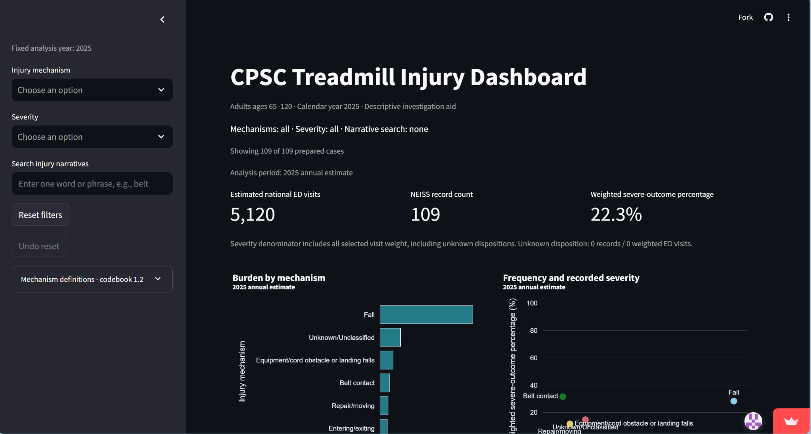

**Screen 2 - Compare mechanisms before filtering.** The unfiltered mechanism and evidence tables report `Fall` as **65 records / 3,114.45 weighted visits / 28.3% recorded severe outcomes**. Other mechanisms remain distinct: equipment/cord obstacle or landing falls **8 / 444.87**, belt contact **9 / 330.43**, and entering/exiting **4 / 254.62**. This is a useful comparison but not a per-user injury-rate ranking.

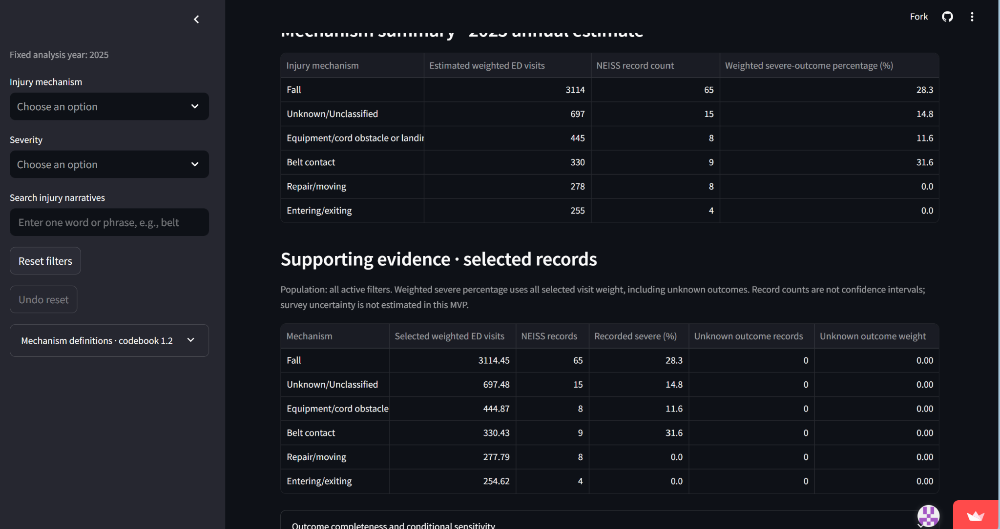

**Screen 3 - Select `Fall`.** The sidebar visibly shows **Injury mechanism = Fall**, with Severity still at all and the narrative search empty. The resulting cohort has **65 of 109 prepared sample records**, **3,114 estimated national ED visits**, and **28.3% weighted severe outcomes**. This confirms that Alex is now viewing only the app's `Fall` mechanism group, not every mechanism involving a fall.

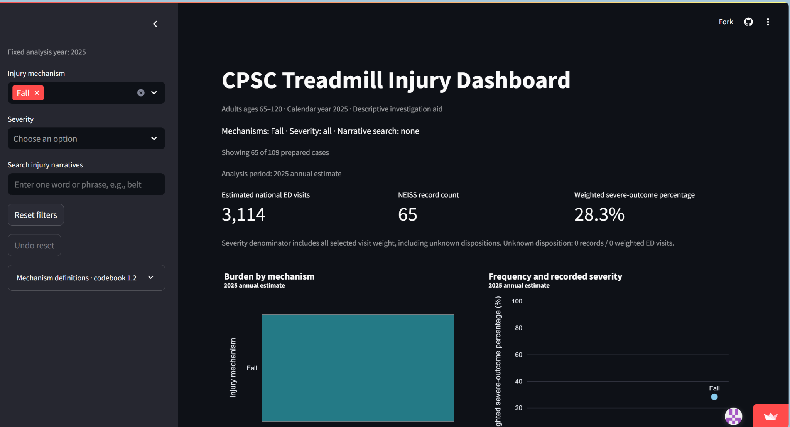

**Screen 4 - Examine fracture diagnoses under `Fall`.** With `Fall` selected, the *Primary-diagnosis composition* chart includes a segment labeled **`57 - FRACTURE`**. Its width is approximately one-third of the weighted Fall visits. The chart screenshot has **no numeric hover tooltip**, so the precise value below comes from the independent validation report [4], not from visual estimation of the bar.

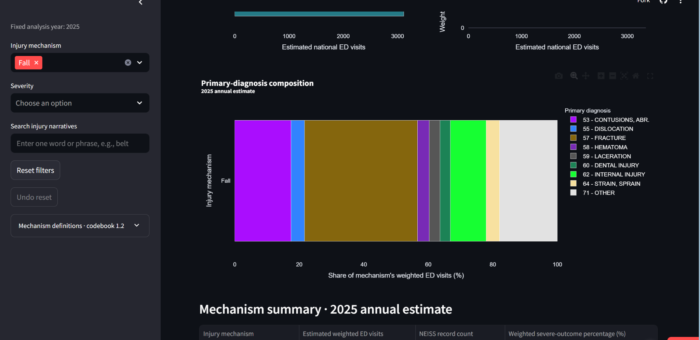

**Screen 5 - Check the evidence denominator.** The filtered *Mechanism summary* and *Supporting evidence* tables show **3,114.45 selected weighted visits**, **65 NEISS sample records**, **28.3% recorded severe outcomes**, and **zero unknown-outcome records**. The dashboard itself warns that visits are not unique people, no exposure denominator is available, and statistical precision is not estimated in this MVP.

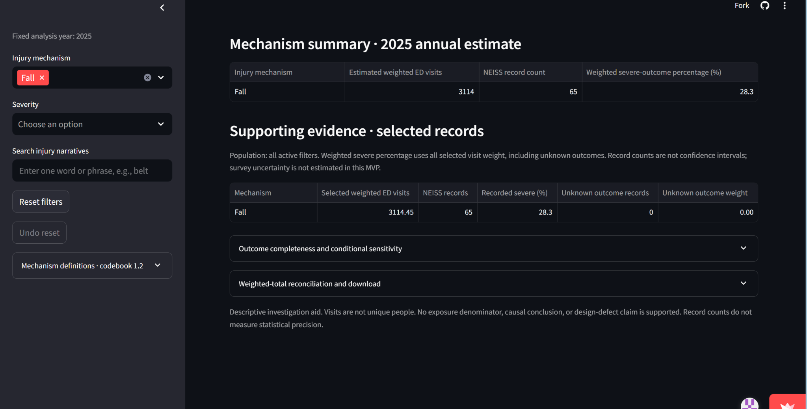

**Independent arithmetic check.** The team's independent validation report [4] gives **1,092.5582 fracture-primary-diagnosis weighted visits** among **3,114.4453 `Fall` weighted visits**. Therefore the fracture share is `1,092.5582 / 3,114.4453 x 100 = 35.1%` (one decimal). It also reconciles the all-mechanism total to **109 records and 5,119.6280 weighted ED visits**, consistent with the live app's rounded **5,120** headline. This comparison checks the numerical result without claiming the app has measured patient-level risk.

### 4. Reading the result for their decision

**Does the number measure what this person cares about?** **Only partly.** The validated **35.1%** is the share of weighted `Fall`-mechanism **ED visits** with a primary fracture diagnosis, **not** a 35.1% chance that a treadmill user will fracture a bone. It also does not quantify how many fracture injuries a discharge handout could prevent. The `Fall`-filtered dashboard directly confirms **28.3% recorded severe outcomes** and **65 underlying records**. The severity metric is based on recorded ED dispositions, not fracture severity or long-term disability. The right denominator for the 35.1% figure is **all weighted `Fall` ED visits (3,114.4453)**, not all people using treadmills.

**Who is in the rows, and who is not?** The dashboard uses **109 retained sample records** of 2025 treadmill-related ED presentations involving adults aged 65-120, selected after the team's review of **188 candidates** (**79 excluded**) [4]. With `Fall` selected, the app visibly narrows this to **65 records**, and the filtered evidence table shows **zero unknown dispositions**. It does not represent all treadmill users, all uninjured exposures, non-ED care, or patients at Alex's own hospital. The weighted national estimates are not 5,120 separately observed patients, and the `Fall` diagnosis pattern rests on **65 sample records**, without a reported confidence interval.

**What outside the data matters?** Alex would still need the hospital's actual discharge population and local injury history, patients' mobility and treadmill use, clinician-approved advice, and evidence-based post-discharge fall-prevention practices [1, 2]. CPSC surveillance is useful for identifying possible hazards but does not by itself establish the product's causal role or a successful prevention intervention [3].

**What could Alex wrongly conclude?** One error would be to treat **35.1%** as a per-user fracture probability, leading to exaggerated treadmill-specific warnings. Another would be to treat `Fall` as **all** treadmill falls: the dashboard also lists separate entering/exiting, belt-contact and equipment/cord mechanisms. Either misunderstanding could divert limited teaching time from more evidence-based, patient-specific fall prevention.

**Reproducible arithmetic check based on source [4]** (not a fresh live-data extraction):

```python
fracture_weight = 1092.5582
fall_weight = 3114.4453
print(f"{100 * fracture_weight / fall_weight:.1f}%")
# 35.1%
```

### 5. The verdict: prove or break

**Verdict - Break for the decision, retain as an investigative aid.** The app is better than no structured national surveillance view: it makes the selected injury patterns, sample sizes and severe-outcome definitions visible. **It is not sufficient to decide whether this hospital should prioritize a treadmill-fracture discharge section.** Alex should use it to propose questions for local data review, then compare the answer with STEADI practices and the hospital's own patients. Do **not** use it as a patient-level risk calculator, evidence of treadmill causation, or proof that a handout will reduce fractures.

**Change request (useful to other users too).** Add an optional **Primary diagnosis** filter (e.g., `Fracture`) so clinical educators and investigators can view fracture-coded ED visits **across all injury mechanisms**, with explicit weighted ED visit totals, NEISS record counts and active filters. Keep the current unfiltered view as the default. This expands diagnosis-focused comparisons without weakening the existing mechanism view.

**Acceptance check:** The optional `Primary diagnosis` multiselect must preserve the all-diagnosis default, display active filters, selected weighted visits and NEISS counts, map `Fracture` to diagnosis code 57, and restore **109 records / 5,119.6280 weighted visits** when cleared.

### Release response to the cases

The preceding case narratives, screenshots and Break verdicts document the authors' evaluations of the earlier public release; those evaluations are preserved, not silently rewritten into new approvals. The November 9 implementation responds to two shared requests:

- CR-09: sourced estimate cautions now sit next to the scatter, with a mechanism-specific screening expander. Severe filtering retains the same mechanism/search all-outcome screening population, even when selected records are empty. No survey CV or percentage significance is claimed.
- CR-10 and Colby's related proposal: all selected narratives are now browsable with a blank search. Entering/exiting shows four; Belt contact shows nine; literal getting, got off and belt memberships remain unchanged. Mechanism does not imply belt wear or a defect.

Actual post-deployment screenshots and acceptance results follow. These are implementation verification, not new personal approvals by the case authors. The rehabilitation and diagnosis-filter proposals remain open with the data limits and scope rationale in Design. Historical references to CR-09/10 being open describe the original review; the current implementation commit and evidence below supersede only their implementation status.

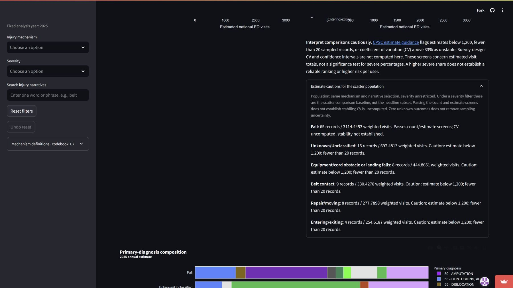

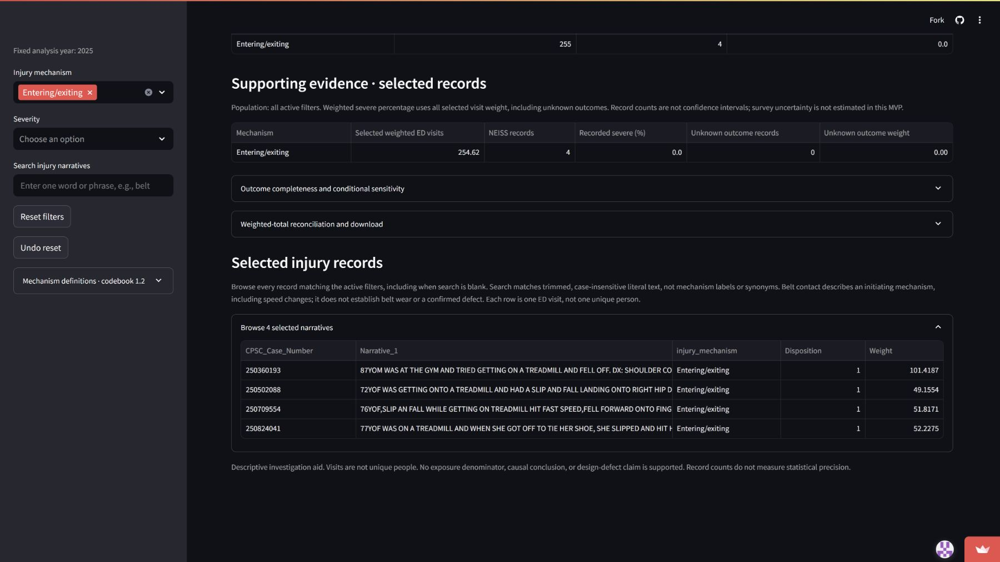

## 3. Numbers

The guarded production workflow passed with **188 completed genuine reviews, 109 Include / 79 Exclude**, zero held cases and exactly 109 retained IDs. All retained weights match the original candidates as Decimal values. The full annual source has 410,201 records / 25 columns and dates January 1-December 31, 2025. Production CSV SHA-256: `c97b9ef421000d5a6e476a5e1598e16d6c8fde9ad20b5cd32d83c626480e985f`. Codebook version **1.2**. No candidate count is presented as an injury estimate.

Total T = **5119.6280 weighted ED visits**, 109 sampled visits. Severe dispositions 2/4/5/8 contribute **1141.8206** weight from **24** visits. S/T x 100 = **22.30280403185543949677593763%** (headline 22.3%). Unknown disposition U = **0**, zero records. Both conditional sensitivity endpoints therefore equal 22.30280403185543949677593763%; these are not confidence intervals.

| Mechanism | Records | Weighted ED visits | Severe records | Severe weight | Severe % |
| --- | ---: | ---: | ---: | ---: | ---: |
| Fall | 65 | 3114.4453 | 18 | 882.6389 | 28.340164 |
| Unknown/Unclassified | 15 | 697.4813 | 3 | 102.9095 | 14.754446 |
| Equipment/cord obstacle or landing falls | 8 | 444.8651 | 1 | 51.8171 | 11.647823 |
| Belt contact | 9 | 330.4278 | 2 | 104.4551 | 31.612080 |
| Repair/moving | 8 | 277.7898 | 0 | 0 | 0.000000 |
| Entering/exiting | 4 | 254.6187 | 0 | 0 | 0.000000 |
| Struck by equipment | 0 | 0 | 0 | 0 | N/A |

All groups use all selected visit weight as the severe denominator. The codebook's Struck category is valid but absent in this cohort; the UI presents only observed mechanisms. Fall is not all fall-involving events: mounting, belt-initiated and equipment obstacle/landing mechanisms are distinct.

Primary diagnosis shares use one `Diagnosis` bucket per visit, divided by all weight in that mechanism; missing/unmapped buckets are preserved. In Fall, fractures (code 57) contribute **1092.5582 / 3114.4453 = 35.08034641032224903741285808%**. The independent report enumerates every diagnosis bucket, not just this example.

All 14 independent scenarios pass: all, six observed mechanisms, each severity, literal belt, literal metacharacters, deliberate empty and Fall + Severe + belt. Unrestricted belt = 3 records / 123.7879 weight / zero severe. Fall + Severe + belt = zero records / zero weight / N/A, not evidence that belt injuries never occur. Severe-only all-cohort = 24 records / 1141.8206 weight / 100%; the comparison baseline remains 109 / 5119.6280 / 22.302804%, retaining other selections. Fall severe baseline remains 65 / 3114.4453 / 28.340164% versus 18 selected severe records / 882.6389 weight.

The independent csv/Decimal method shares no pandas aggregation with the application. It checks exact ID sets, counts, mechanism and diagnosis buckets; weights/percentages use max(1e-8 absolute, 1e-12 relative) tolerance for floating-point dashboard values. CSV contributions reconcile unrounded; the separate selected_total row is not another contribution. Mechanism values rounded separately sum to 5119, while the rounded total is 5120. This one-visit display difference is explained by rounding; no weights were changed. No unexplained discrepancy remains.

Evidence: validation/results/real_2025_results.json, real_2025_dashboard_check.json and real_2025_app_check.json. These establish reviewed-data, builder/export and configured local-app agreement. The actual public UI independently matches the same hash and rounded values. The real public CSV has seven rows (six mechanisms and a separate selected total), 109 records and 5119.6280 weight; filter/period/scope/hash metadata match. The maximum numerical difference is 1E-12 from floating-point serialization. See validation/results/public_dashboard_verification.json and public_export_check.json; the aggregate download is preserved as public_2025_weighted_breakdown.csv.


The earlier invented hand-worked fixture remains documented in validation/results/fixture_results.json and dashboard_fixture_results.json. It tests 120 weight / five records / 41.666667% severe and unknown endpoints 41.666667-75%; it is never substituted for real findings. Canonical integer-code normalization resolved an earlier fixture 53.0-versus-53 representation issue without changing metric definitions. Actual real-data discrepancies are fully resolved; the separate public comparison also passes.

## 4. Tests

**Current strengthened suite: 186 passed, zero failures/errors/skips**, Windows/Python 3.13.15, 15.51 seconds. Six new tests protect the exact count/estimate thresholds, complete blank-search membership, and an empty selected subset with a nonempty scatter baseline. The implementation commit also passed Linux CI and production validators. Current release evidence is in validation/results/stronger_release_20261109.json. The historical runs below show how the test protection developed; they are not the latest test count.

Historical production release suite: **180 passed, 0 failures, 0 errors, 0 skipped**, Windows/Python 3.13.15, JUnit 38.457 seconds. Results and module counts are in validation/results/test_summary.json. That recorded run includes the finalized runtime pair. A complete post-public-evidence rerun also passed all 180 tests in 16.57 seconds, with zero failures/errors/skips; validation/results/live_release_tests.json records the actual report. Two additional taxonomy regressions beyond 178 protect rejection of the old Non-use label and separation of surface Fall from equipment relationship in baselines/exports. The missing-file AppTest now uses an explicitly absent temporary path, preserving that behavior test when production data is shipped; it was not deleted or weakened.

The original build had 87 tests; the team added 93. All eight CRs are protected by tests/test_mvp_changes.py. Preparation/source gates, duplicate/foreign/missing IDs, altered narratives, policy/candidate hashes, reviewer identities, deferred/missing approvals, formula attestations and unresolved taxonomy gaps are rejected. Invented end-to-end checks cover guarded export/finalization and no-overwrite publication; no production bypass flag exists. Software verifies consistency and identity, not whether a reviewer truly read a narrative; genuine approval rests on Ryan's explicit confirmations and adjudications.

Loader/provenance tests reject missing/edited/sample bundles, codebook and lookup mismatches. Filter/view tests protect literal membership, severity/diagnosis baselines, unknown denominators, empty states, reset/session-specific Undo and cache invalidation. Independent Decimal checks protect aggregate and CSV arithmetic; an incorrect-export injection is rejected. Colby's committed tests protect row-order invariance and uniform weight-scaling behavior. Git CRLF tests stage invented bytes and verify CSV/provenance/codebook hashes survive; production staged bytes are also compared directly. The first actual Ubuntu run caught one invented end-to-end fixture regenerating codebook text with Linux newlines, conflicting with the exact-byte guard. Copying canonical bytes fixed the fixture; the guard and production bytes were not changed. The subsequent full Windows suite passed again.

The actual configured local production AppTest uses no fixture injection and checks real metrics/plots/tables, baseline and matching narrative sections, zero selections, codebook and Reset/Undo. The actual [Ubuntu CI run](https://github.com/ryanyu808/project/actions/runs/42125610831) passed **180 tests, zero failures/errors/skips** in 12.00 seconds on Python 3.13.18, plus pinned dependency installation/checks, real independent numbers, dashboard filters/baselines/CSV and production AppTest. Its actual Streamlit health returned ok and root HTTP succeeded. The matching Windows-produced hashed bundle therefore loads on Linux. See deployment/CI_RESULTS.md and validation/results/linux_production_check.json. Public browser verification is separately evidenced in Cases; it was performed in a separate browser session without signing in, rather than inferred from CI.

Release guards exclude raw downloads, private reviews/workbooks/audits, environments, caches and secret patterns. Final runtime CSV/provenance/codebook bytes are preserved exactly by Git attributes, and provenance publishes only a source basename. Source data, the original candidate/review CSV, inclusion-policy bytes and one-shot prompt remain preserved. The machine release audit checks committed runtime, links, secret patterns and tracked cleanliness; its PASS alone does not establish the required team case coverage. The public screenshots, owned Ryan verdict and genuine 300-second video are now present. Five distinct teammate/Ryan cases are now integrated and inspected; automated passes supplement their decision analysis.

Final integration rerun: **180 passed, zero failures/errors/skips**, Python 3.13.15 on Windows, 13.70 seconds (November 9). An initial attempt had 78 temporary-directory setup errors because its parent folder did not exist; creating that output folder resolved the harness issue without changing application code or tests. Independent production validators and the teammate numerical checks were rerun; see validation/results/final_release_20261109.json.

Strengthened release checks: **186 passed** on Windows Python 3.13.15 in **15.51 seconds**, including six additional count/estimate-boundary, blank-search membership and empty-selected/nonempty-baseline regressions. Production dashboard/CSV and configured AppTest still pass with unchanged 109 records and 5119.6280 weight. The archive helper now checks regular files rather than mistaking the data/prepared directory marker for a private file. All file-level private-path and source-validation guards remain unchanged.
