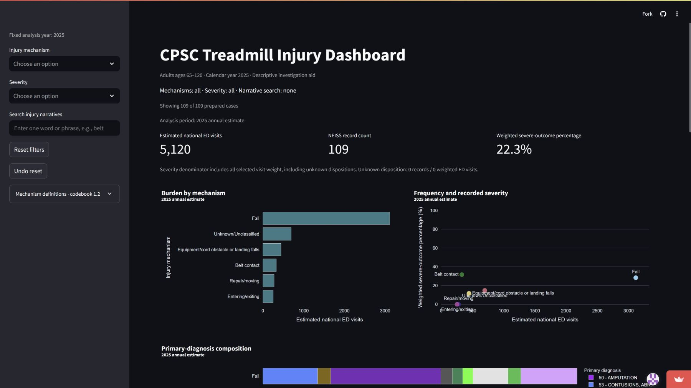
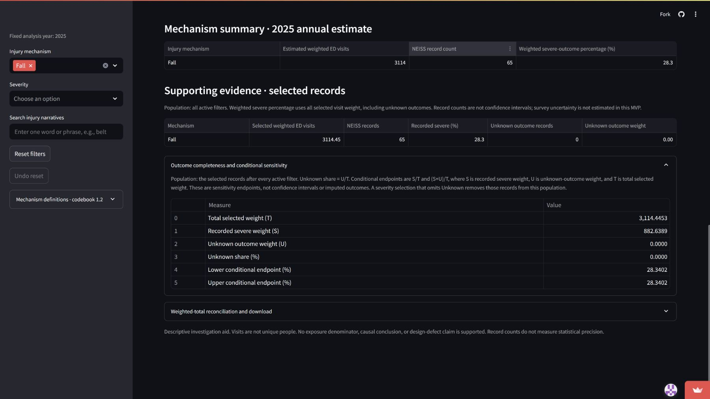
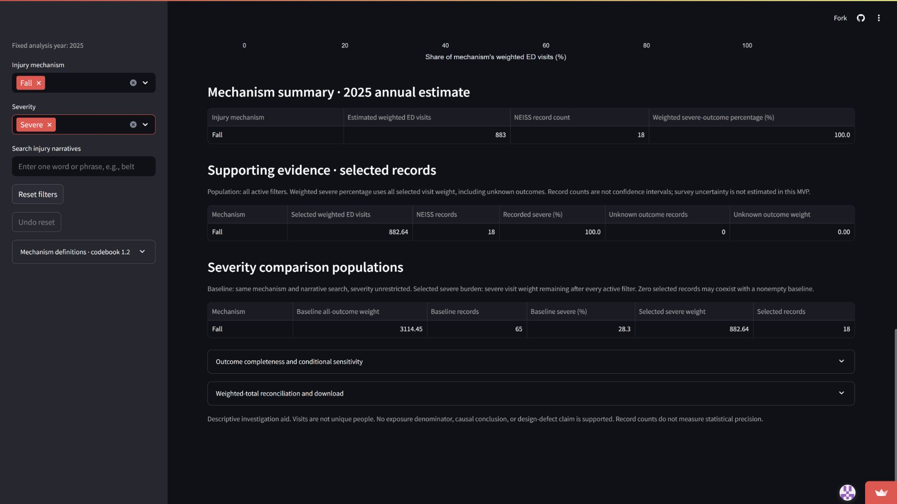
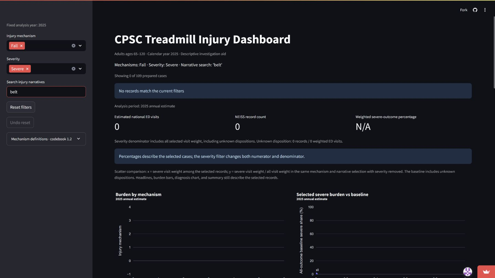
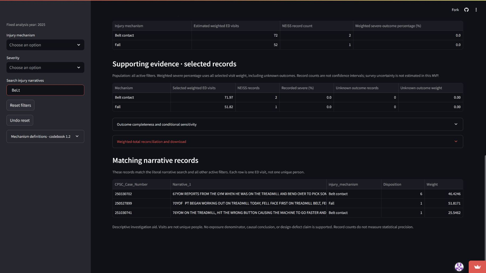

# MVP validation

**Verified production and public evidence - November 5-6, 2026 Pacific.** The public app, real downloaded CSV and genuine screenshots are checked. Ryan explicitly accepts his HW11 break verdict. The individual case is complete; team case coverage remains incomplete because legitimate distinct teammate cases were not present. The genuine narrated demo is uploaded Unlisted and plays without signing in: [watch the demo](https://www.youtube.com/watch?v=f45CShykzbI).

This dashboard helps a CPSC epidemiology analyst prioritize questions about treadmill injury mechanisms among adults 65-120. It combines weighted ED burden, recorded severe outcomes, primary diagnoses and original narratives. The genuine 2025 cohort contains 109 approved visits from 188 screened candidates; 79 are excluded under Ryan's accepted injury-focused policy. The annual source has 410,201 records and 25 original fields. One row is one ED visit; no exposure-adjusted risk, causation or automatic priority is inferred.

## 1. Design

The CPSC [NEISS FAQ](https://www.cpsc.gov/Research--Statistics/NEISS-Injury-Data/Neiss-Frequently-Asked-Questions) describes surveillance estimates and follow-back investigation, and distinguishes product association from causation. This supports an investigation-screening use case. Our particular interface, role scenarios and prioritization workflow are design hypotheses; no interview, usability study or observed analyst adoption is claimed. Direct analyst/user corroboration of workflow and usefulness has not been established; source-backed scenarios and Ryan's evaluation are the available design evidence.

The intended decision is where to spend limited follow-up attention, rather than whether a product is defective. Burden and severe share answer different questions: estimated volume versus recorded outcomes among visits. Diagnosis and narratives add context; visible evidence and missing outcomes help prevent overreading a high percentage supported by few records. The following eight changes extend the professor's starting build and remain protected by automated tests.

| Change request | Implemented behavior and decision rationale |
| --- | --- |
| CR-01 | Selected severe burden alongside all-outcome severe share, retaining mechanism/search. Prevents a severe-only filter from flattening every nonempty percentage to 100%. |
| CR-02 | Visible mechanism record counts and unknown-disposition counts/weights. Makes evidence volume and missingness inspectable without inventing precision thresholds. |
| CR-03 | Primary-diagnosis baseline beside selected composition under severity filtering. Keeps clinical context from being silently redefined. |
| CR-04 | Matching IDs and original narratives after all active filters. Enables users to examine what a literal search actually selected. |
| CR-05 | Reset and session-specific Undo reset. Restores the complete prior mechanism/severity/search selection for comparison. |
| CR-06 | Unknown share and none/all-unknown-severe endpoints. Shows the decision impact of missing outcomes without imputing values. |
| CR-07 | In-app mechanism definitions, version and initiating-event precedence. Makes taxonomy interpretation visible. |
| CR-08 | Full-precision contribution reconciliation and CSV with filter/period/data hash. Explains display rounding and supports independent audit. |

The team deliberately did not build exposure-adjusted risk, geographic/brand attribution, prediction, causal defect detection, significance claims or automatic investigation recommendations. The data and design do not support them. Source period is fixed to 2025; year-range controls and trends would require additional agreed artifacts and sampling interpretation. Counts are not confidence intervals, and no design-based uncertainty is estimated.

Meaningful alternatives are the official [NEISS query builder](https://www.cpsc.gov/Research--Statistics/NEISS-Injury-Data/Instructions-for-Using-the-NEISS-Estimates-Query-Builder), an independent spreadsheet/script, and CPSC follow-back investigation. The official query provides selectable confidence intervals/CV and downloadable records; it does not automatically reproduce our narrative-screened, manually classified cohort. A separate analysis can explore broader fall-involving definitions but takes reconciliation work. Follow-back can supply circumstances absent from short narratives; this dashboard cannot replace it. A database or automated classifier does not supply missing narrative circumstances or evidence of usefulness. Small, precomputed flat files keep interactions in memory and avoid exposing preparation inputs.

Preparation, loading, filtering, aggregation and UI wiring remain separate. Source and candidate fingerprints bind a completed review to its exact export; the loader rejects missing, edited, incomplete or sample artifacts instead of silently displaying national estimates. The injury-focused policy narrows the original broader involvement contract. Ryan explicitly accepts the matching policy and confirms his case review. The policy document retains its original authorship/fingerprint, and the actual acceptance is preserved in private review documentation. His subsequent version 1.2 taxonomy clarification supersedes only the old mechanism-version reference; inclusion scope and the original prompt are not silently changed. All records and taxonomy boundaries require real human verification; AI agreement does not satisfy that gate.

Genuine public evidence appears in Cases, with visible controls and recorded capture times. Ryan accepts the interpretation and break verdict for Alex. CR-09 requests sourced stability/uncertainty context beside the scatter and remains open. No independent analyst interview, usability experiment or observed adoption is claimed.

The accepted 1.2 clarification replaces a use-status assumption with Equipment/cord obstacle or landing falls. It describes eight equipment-relationship cases without asserting non-use, motor state or the initial cause of imbalance. Operating/on-from-supporting-surface falls remain Fall; more specific initiating mechanisms retain precedence. The four final mappings were explicitly authorized in Ryan's FINAL RELEASE message. The original 171 approvals and their later personal confirmation are preserved; no additional independent inspection is claimed. All 188 reviews now satisfy the unchanged source-bound guards. Earlier codebook versions and source/AI fields are preserved.

## 2. Cases

Ryan's complete five-part individual case follows, including its difficult empty subset and uncertainty-driven break. It covers the research-backed analyst persona; it does not substitute for the team's required several personas. No legitimate distinct teammate case files were found in the repository or fetched main. Their owned interpretations and difficult-case coverage must be supplied by the team before the team package is submission-ready; no teammate work is invented. The individual HW11 PDF remains outside the team ZIP.

**Ryan Yu's HW11 case - verified public evidence, November 5, 2026 (Pacific).** Ryan explicitly accepted the break conclusion in chat. The assistant operated and captured the live app; this is a researched fictional-person scenario, not an interview or an observed CPSC user study.

### 1. The person and the decision

Alex is a fictional CPSC epidemiology analyst, not someone interviewed. During investigation planning, Alex decides whether treadmill-related falls among adults 65 and older merit priority over other treadmill mechanisms for follow-up. A poor choice could divert limited investigative attention from a more consequential or informative pattern. The dashboard offers descriptive screening evidence, not a prescribed CPSC ranking rule.

### 2. Their real situation and alternatives

The CPSC [NEISS Frequently Asked Questions](https://www.cpsc.gov/Research--Statistics/NEISS-Injury-Data/Neiss-Frequently-Asked-Questions) describes screening surveillance data and follow-back investigation for additional circumstances. That supports the plausibility of Alex's role. It does not establish that CPSC uses this dashboard, that Alex is a real employee, or that burden alone sets priorities. Product association in an ED record does not prove that the product caused the injury.

The official [NEISS Estimates Query Builder instructions](https://www.cpsc.gov/Research--Statistics/NEISS-Injury-Data/Instructions-for-Using-the-NEISS-Estimates-Query-Builder) document filters, records and optional coefficient-of-variation/confidence-interval outputs. That is one alternative, alongside a reconciled spreadsheet/script. Its broader product query is not automatically our narrative-screened, human-classified cohort. CPSC's [Explanation of NEISS Estimates](https://www.cpsc.gov/Research--Statistics/NEISS-Injury-Data/Explanation-Of-NEISS-Estimates-Obtained-Through-The-CPSC-Website) explains variability and estimate interpretation. Follow-back can add product/environment/medical circumstances absent from terse narratives. These tools complement our fast coordinated comparisons; they are not displaced by the app.

### 3. The app in use

**Live app:** [CPSC Treadmill Injury Dashboard](https://treadmill-injury-dashboard.streamlit.app/). The assistant opened it in a separate browser session without signing in, observed the public viewer interface, and exercised the controls. Genuine captures were made November 6, 2026 UTC (November 5 Pacific). No local app, reconstructed image or invented result is used. The live reconciliation displayed production SHA-256 c97b9ef421000d5a6e476a5e1598e16d6c8fde9ad20b5cd32d83c626480e985f.

Alex starts with all controls clear, compares mechanisms, then selects Fall and Severe to inspect a follow-up shortlist. Searching belt tests a difficult empty subset rather than hiding it. Finally, removing those two filters reveals what the literal search actually matches.

| Screen and exact selections | Observed public result and decision relevance |
| --- | --- |
| A: Fixed 2025; mechanism all; severity all; search blank | 5,120 weighted visits / 109 records / 22.3% severe. Fall: 65 / 3114.4453 / 28.340164%. Belt contact: 9 / 330.4278 / 31.612080%. Burden and severe share give different rankings. |
| B: Fall; severity all; search blank | 65 records / 3114.4453 weight; 18 severe / 882.6389 weight. Unknown weight zero; both conditional endpoints 28.340164%. This is outcome completeness, not sampling certainty. |
| C: Fall; Severe; search blank | Selected 18 / 882.6389 / 100%; comparison baseline 65 / 3114.4453 / 28.340164%. The table and diagnosis baseline prevent confusing these populations. |
| D: Fall; Severe; search belt | Zero records / zero weight / N/A with explicit empty result. An empty intersection is not absence of belt injuries overall. Reset then Undo restores all three selections. |
| E: Mechanism all; severity all; search BeLt with surrounding spaces | Three nonsevere records / 123.7879 weight. Matching IDs and original narratives expose which visits the literal, trimmed, case-insensitive search selected. |

**Public evidence figures A-E.** Captions identify the active controls; the original full captures are preserved unchanged. See the machine-readable capture manifest for exact UTC times and hashes.

The actual public download independently reconciles all six contributions and the selected-total row to 109 records and 5119.6280 weight, with matching period/scope/filters/data hash. The maximum float difference is 1E-12. Decimal computations, dashboard validators and configured local AppTest provide a different method from visually reading rounded values. Fall primary-fracture weight is 1092.5582, or 35.080346% of Fall weight. Evidence and reproducible commands are in validation/REAL_DATA_RESULTS.md and validation/results/public_export_check.json.

### 4. Reading the result for their decision

**Does the measure fit?** Fall has the greatest weighted burden of the six observed mutually exclusive categories: 3114.4453 of 5119.6280 weighted visits, supported by 65 of 109 sampled visits. Its 28.340164% severe share is above the all-cohort 22.302804%, but below Belt contact's 31.612080% from only nine records (two severe). Those descriptive contrasts are screening evidence; without survey-design uncertainty, they do not establish a stable difference. The app measures ED burden and recorded disposition, not preventability, investigation value or risk per user (kinds 3, 4 and 9 in Module 11).

The [CPSC estimate guidance](https://www.cpsc.gov/Research--Statistics/NEISS-Injury-Data/Explanation-Of-NEISS-Estimates-Obtained-Through-The-CPSC-Website) flags national estimates below 1,200, fewer than 20 cases, or CV above 33% as unstable. Every observed non-Fall mechanism is below the first two thresholds. Fall's 65 records / 3114.4453 pass those two screens, but its CV is uncomputed, so stability is not certified. Its severe subset (18 / 882.6389) is also small. These are national-estimate reporting cautions, not a significance test for differences in severe percentages.

**Who is in the rows?** One row is one ED visit, not one unique person. The full annual source has 410,201 records / 25 original columns; 188 candidates satisfy age 65-120, product 3277 and literal treadmill mention. Ryan's accepted injury-focused policy and genuine review retain 109 and exclude 79, including medical-only or incidental unrelated episodes. Other ages, non-ED injuries, missing mentions, other years and reviewed exclusions are absent (kinds 1, 2 and 5). The codebook's Fall is not every fall-involving injury: mounting, initiating belt and equipment obstacle/landing mechanisms are separated. The eight equipment cases do not establish power/use status. A broader all-fall question requires deliberate cross-category narrative analysis, not summing every belt or mounting case automatically.

**What outside the data matters?** Exposure to treadmill use, baseline health, medical triggers, investigation feasibility, preventability and new incident information could change priority. Neither the app nor these brief records supplies a causal comparison or usage denominator (kinds 7 and 8). Fractures contribute 35.080346% of Fall weight, which supports asking about clinical consequences in follow-up; it does not identify a design defect. A count is not statistical precision. The official uncertainty-capable tools and follow-back are essential complements.

**What could Alex misread?** The Fall + Severe headline is 100% because the selected denominator contains only severe visits; its explicit baseline remains 28.340164% (kind 6). The empty Fall + Severe + belt subset cannot show belt events never occur. All-cohort belt search actually returns three nonsevere records / 123.7879 weight. Outcome unknown weight is zero here, so the two endpoints coincide, but this does not eliminate sampling or eligibility uncertainty. Code 57 is the primary fracture bucket only, not every diagnosis. None of these figures measures injury probability per treadmill user.

### 5. The verdict: prove or break

**Ryan's accepted verdict: break.** Fall's 65 records and 3114.4453 weighted visits support a follow-up shortlist. Belt contact's 31.612080% severe share from nine records, compared with Fall's 28.340164%, does not establish a reliable ranking. Use the app to assemble questions and inspect evidence, not to declare a unique winner, causal defect, or exposure-adjusted risk.

The coordinated baselines, original matching records and exact reconciliation reduce comparison work relative to repeatedly reconciling a spreadsheet. The official query offers uncertainty outputs; follow-back supplies circumstances missing from narratives; separate analysis can examine broader fall-involving events. The app is a useful screening companion, but it is not yet as good as it gets for Alex. Clearer CPSC stability/uncertainty context belongs beside the scatter for all mechanisms. This also helps other users avoid interpreting small-group percentage differences as a precise ranking, without changing their numbers or imposing a case-specific rule.

Ryan explicitly answered "Accept this break conclusion" in chat. This owns the interpretation above; the captures were performed by the assistant, and no analyst interview or personal browser action by Ryan is claimed. The following request is recorded in change-requests.md and remains open:

#### CR-09: Put estimate stability and uncertainty context beside the scatter

- **From:** Ryan Yu, 2026-11-05; explicitly accepted the HW11 break conclusion in chat.
- **Part:** Frequency-severity scatter and interpretation of mechanism comparisons.
- **Evidence:** Genuine public 2025 app: Fall has 65 records / 3114.4453 weighted visits / 28.340164% severe; Belt contact has nine records / 330.4278 weighted visits / 31.612080% severe, from two severe records. CPSC flags national estimates below 1,200, fewer than 20 cases, or CV above 33% as unstable. Every observed non-Fall mechanism is below the first two screens; Fall passes those two but its CV is uncomputed. Its severe subset is also small (18 / 882.6389). These screens are not a significance test for differences in percentages. Screenshots and public CSV checks are in cases/screenshots and validation/results/public_dashboard_verification.json.
- **Change:** Place clear, sourced CPSC stability/uncertainty context adjacent to the scatter for all mechanisms. Explain that differences are descriptive and survey-design uncertainty is not estimated. If validated design-based intervals are later available, show them with their assumptions; do not use naive binomial intervals on weighted visits. Retain visible counts and baselines. Apply the explanation consistently across users and filters, without declaring significance or automatically ranking priorities.
- **Priority:** medium
- **Status:** open
- **Acceptance:** Ryan's response was "Accept this break conclusion". This records his owned evaluation, not a new user study or an implemented feature. CR-02 already supplies counts/unknowns and a general caveat; this request adds sourced stability context at the point of scatter interpretation.

## 3. Numbers

The guarded production workflow passed with **188 completed genuine reviews, 109 Include / 79 Exclude**, zero held cases and exactly 109 retained IDs. All retained weights match the original candidates as Decimal values. The full annual source has 410,201 records / 25 columns and dates January 1-December 31, 2025. Production CSV SHA-256: `c97b9ef421000d5a6e476a5e1598e16d6c8fde9ad20b5cd32d83c626480e985f`. Codebook version **1.2**. No candidate count is presented as an injury estimate.

Total T = **5119.6280 weighted ED visits**, 109 sampled visits. Severe dispositions 2/4/5/8 contribute **1141.8206** weight from **24** visits. S/T x 100 = **22.30280403185543949677593763%** (headline 22.3%). Unknown disposition U = **0**, zero records. Both conditional sensitivity endpoints therefore equal 22.30280403185543949677593763%; these are not confidence intervals.

| Mechanism | Records | Weighted ED visits | Severe records | Severe weight | Severe % |
| --- | ---: | ---: | ---: | ---: | ---: |
| Fall | 65 | 3114.4453 | 18 | 882.6389 | 28.340164 |
| Unknown/Unclassified | 15 | 697.4813 | 3 | 102.9095 | 14.754446 |
| Equipment/cord obstacle or landing falls | 8 | 444.8651 | 1 | 51.8171 | 11.647823 |
| Belt contact | 9 | 330.4278 | 2 | 104.4551 | 31.612080 |
| Repair/moving | 8 | 277.7898 | 0 | 0 | 0.000000 |
| Entering/exiting | 4 | 254.6187 | 0 | 0 | 0.000000 |
| Struck by equipment | 0 | 0 | 0 | 0 | N/A |

All groups use all selected visit weight as the severe denominator. The codebook's Struck category is valid but absent in this cohort; the UI presents only observed mechanisms. Fall is not all fall-involving events: mounting, belt-initiated and equipment obstacle/landing mechanisms are distinct.

Primary diagnosis shares use one `Diagnosis` bucket per visit, divided by all weight in that mechanism; missing/unmapped buckets are preserved. In Fall, fractures (code 57) contribute **1092.5582 / 3114.4453 = 35.08034641032224903741285808%**. The independent report enumerates every diagnosis bucket, not just this example.

All 14 independent scenarios pass: all, six observed mechanisms, each severity, literal belt, literal metacharacters, deliberate empty and Fall + Severe + belt. Unrestricted belt = 3 records / 123.7879 weight / zero severe. Fall + Severe + belt = zero records / zero weight / N/A, not evidence that belt injuries never occur. Severe-only all-cohort = 24 records / 1141.8206 weight / 100%; the comparison baseline remains 109 / 5119.6280 / 22.302804%, retaining other selections. Fall severe baseline remains 65 / 3114.4453 / 28.340164% versus 18 selected severe records / 882.6389 weight.

The independent csv/Decimal method shares no pandas aggregation with the application. It checks exact ID sets, counts, mechanism and diagnosis buckets; weights/percentages use max(1e-8 absolute, 1e-12 relative) tolerance for floating-point dashboard values. CSV contributions reconcile unrounded; the separate selected_total row is not another contribution. Mechanism values rounded separately sum to 5119, while the rounded total is 5120. This one-visit display difference is explained by rounding; no weights were changed. No unexplained discrepancy remains.

Evidence: validation/results/real_2025_results.json, real_2025_dashboard_check.json and real_2025_app_check.json. These establish reviewed-data, builder/export and configured local-app agreement. The actual public UI independently matches the same hash and rounded values. The real public CSV has seven rows (six mechanisms and a separate selected total), 109 records and 5119.6280 weight; filter/period/scope/hash metadata match. The maximum numerical difference is 1E-12 from floating-point serialization. See validation/results/public_dashboard_verification.json and public_export_check.json; the aggregate download is preserved as public_2025_weighted_breakdown.csv.

The earlier invented hand-worked fixture remains documented in validation/results/fixture_results.json and dashboard_fixture_results.json. It tests 120 weight / five records / 41.666667% severe and unknown endpoints 41.666667-75%; it is never substituted for real findings. Canonical integer-code normalization resolved an earlier fixture 53.0-versus-53 representation issue without changing metric definitions. Actual real-data discrepancies are fully resolved; the separate public comparison also passes.

## 4. Tests

Full repository suite: **180 passed, 0 failures, 0 errors, 0 skipped**, Windows/Python 3.13.15, JUnit 38.457 seconds. Results and module counts are in validation/results/test_summary.json. That recorded run includes the finalized runtime pair. A complete post-public-evidence rerun also passed all 180 tests in 16.57 seconds, with zero failures/errors/skips; validation/results/live_release_tests.json records the actual report. Two additional taxonomy regressions beyond 178 protect rejection of the old Non-use label and separation of surface Fall from equipment relationship in baselines/exports. The missing-file AppTest now uses an explicitly absent temporary path, preserving that behavior test when production data is shipped; it was not deleted or weakened.

The original build had 87 tests; the team added 93. All eight CRs are protected by tests/test_mvp_changes.py. Preparation/source gates, duplicate/foreign/missing IDs, altered narratives, policy/candidate hashes, reviewer identities, deferred/missing approvals, formula attestations and unresolved taxonomy gaps are rejected. Invented end-to-end checks cover guarded export/finalization and no-overwrite publication; no production bypass flag exists. Software verifies consistency and identity, not whether a reviewer truly read a narrative; genuine approval rests on Ryan's explicit confirmations and adjudications.

Loader/provenance tests reject missing/edited/sample bundles, codebook and lookup mismatches. Filter/view tests protect literal membership, severity/diagnosis baselines, unknown denominators, empty states, reset/session-specific Undo and cache invalidation. Independent Decimal checks protect aggregate and CSV arithmetic; an incorrect-export injection is rejected. Colby's committed tests protect row-order invariance and uniform weight-scaling behavior. Git CRLF tests stage invented bytes and verify CSV/provenance/codebook hashes survive; production staged bytes are also compared directly. The first actual Ubuntu run caught one invented end-to-end fixture regenerating codebook text with Linux newlines, conflicting with the exact-byte guard. Copying canonical bytes fixed the fixture; the guard and production bytes were not changed. The subsequent full Windows suite passed again.

The actual configured local production AppTest uses no fixture injection and checks real metrics/plots/tables, baseline and matching narrative sections, zero selections, codebook and Reset/Undo. The actual [Ubuntu CI run](https://github.com/ryanyu808/project/actions/runs/42125610831) passed **180 tests, zero failures/errors/skips** in 12.00 seconds on Python 3.13.18, plus pinned dependency installation/checks, real independent numbers, dashboard filters/baselines/CSV and production AppTest. Its actual Streamlit health returned ok and root HTTP succeeded. The matching Windows-produced hashed bundle therefore loads on Linux. See deployment/CI_RESULTS.md and validation/results/linux_production_check.json. Public browser verification is separately evidenced in Cases; it was performed in a separate browser session without signing in, rather than inferred from CI.

Release guards exclude raw downloads, private reviews/workbooks/audits, environments, caches and secret patterns. Final runtime CSV/provenance/codebook bytes are preserved exactly by Git attributes, and provenance publishes only a source basename. Source data, the original candidate/review CSV, inclusion-policy bytes and one-shot prompt remain preserved. The machine release audit checks committed runtime, links, secret patterns and tracked cleanliness; its PASS alone does not establish the required team case coverage. The public screenshots, owned Ryan verdict and genuine 300-second video are now present. Legitimate distinct teammate cases remain outstanding; automated passes do not satisfy them.
